<div align="center">

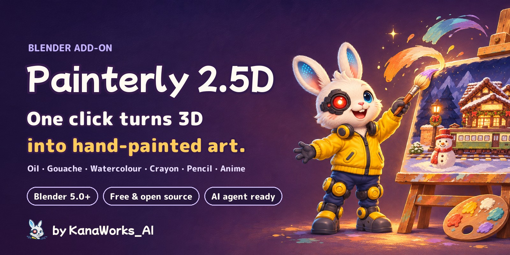

<p>
  <a href="https://github.com/kanaworksai-hue/painterly-25d/releases/latest"></a>
  
  
  
  
  <a href="LICENSE"></a>
  <a href="NOTICE.md"></a>
  <a href="https://github.com/kanaworksai-hue/painterly-25d/stargazers"></a>
</p>

<p><a href="https://github.com/kanaworksai-hue"></a>&nbsp;<a href="https://github.com/kanaworksai-hue"><b>A KanaWorks_AI project</b></a>&nbsp;·&nbsp;<a href="#-kanaworks-add-ons">More add-ons</a></p>

[日本語](README.md) | **English** | [简体中文](README.zh-CN.md) | [한국어](README.ko.md) | [Português](README.pt-BR.md) | [Español](README.es.md)

[🎨 Gallery](#-gallery) · [🚀 Get started](#-get-started) · [🎛️ What you can tweak](#️-what-you-can-tweak) · [❓ FAQ](#-faq) · [⭐ Star it](#-support-with-a-star)

</div>

**Painterly 2.5D** is a free Blender add-on that turns any scene into a hand-painted picture with one click. It adds toon shading with brush strokes only where light meets shadow, hand-drawn outlines that wobble on twos, and an oil-paint finishing filter, all at once.

Pick from **six media: oil, gouache, watercolour, crayon, coloured pencil and anime cel**. Hit **Shuffle** and the brush direction and colours change every time, so the same scene never has to look the same twice. You can also ask an AI agent to install and apply it for you in one sentence.

<p align="center">
  
  <br><sub>Same scene, same camera. Left: a normal render. Right: Painterly 2.5D.</sub>
</p>

## ✨ Features

<table>
<tr>
<td align="center" width="25%">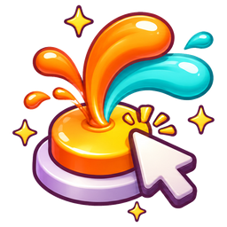<br><b>One click</b><br><sub>Sets up EEVEE, materials, outlines and the compositor in one go</sub></td>
<td align="center" width="25%">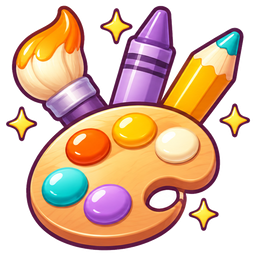<br><b>Six media</b><br><sub>Oil, gouache, watercolour, crayon, coloured pencil, anime cel</sub></td>
<td align="center" width="25%">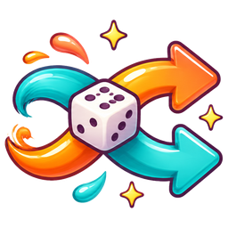<br><b>Shuffle</b><br><sub>Every click re-rolls brush direction, colour jitter, shadow hue, line colour and paper</sub></td>
<td align="center" width="25%">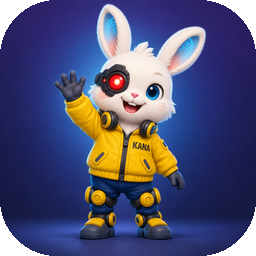<br><b>Ask your AI</b><br><sub>One sentence to your agent: install, apply and preview, all automatic</sub></td>
</tr>
</table>

- **Works on any scene:** objects without materials get one (vertex colours are kept), and a key light is added when the scene has none. Diffuse, Emission, image-only and node-group materials keep their colours, glass and see-through surfaces are left alone, and collection instances are included.
- **Fits any scale:** brush size, depth fog and outline fade follow your object size and camera distance, so a 10 cm product and a 50 m building both look right.
- **Lines in the model's colour:** outlines can use a darker shade of each object's own colour (or one ink colour everywhere).
- **Five presets:** Blue-hour Night, Golden Hour, Pastel Sweets, Storybook Day and Clean / Product. Mix them with any medium.
- **Reversible:** *Revert Painterly* restores your materials, compositor and view settings. Settings are read inside the shader, so files render the same even without the add-on installed.
- **UI in English, 日本語 and 简体中文:** it follows *Preferences › Interface › Translation*.

## 🎨 Gallery

### Six media

Same model, same light. Only the medium changes.

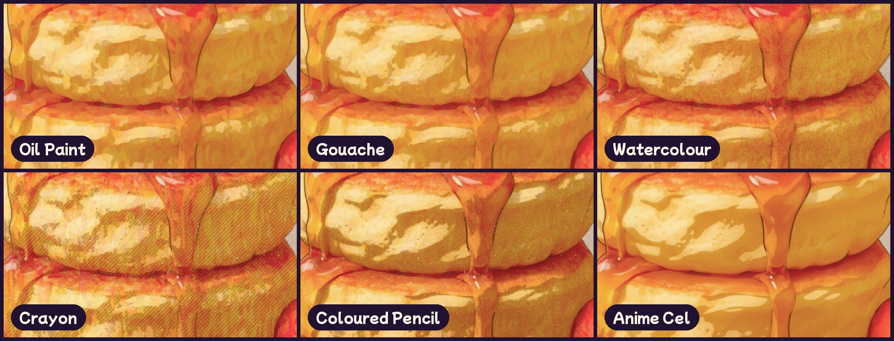

### Shuffle

Every click randomly changes the brush direction, colour jitter, shadow hue, line colour and paper colour, within the range of your preset and medium. Write down the number and you can get the same look back any time.

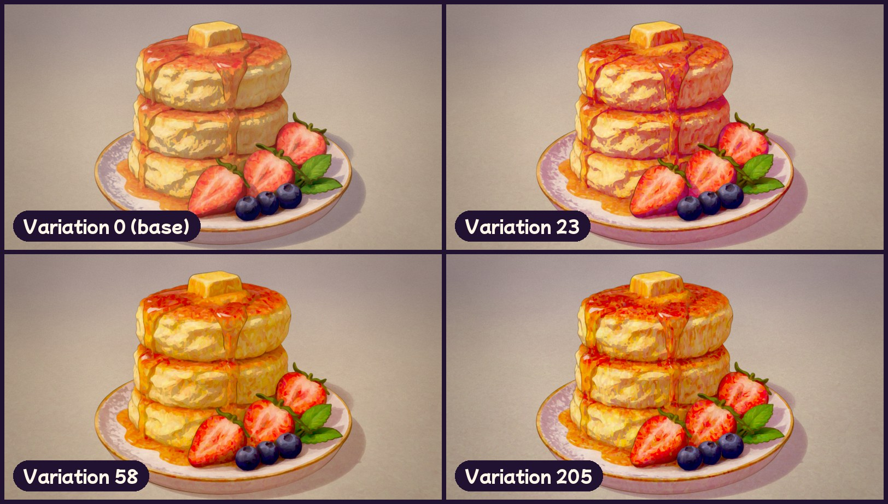

### Any model

CC0 models, Blender's own Suzanne and the author's models, each with a single click.


### Three layers

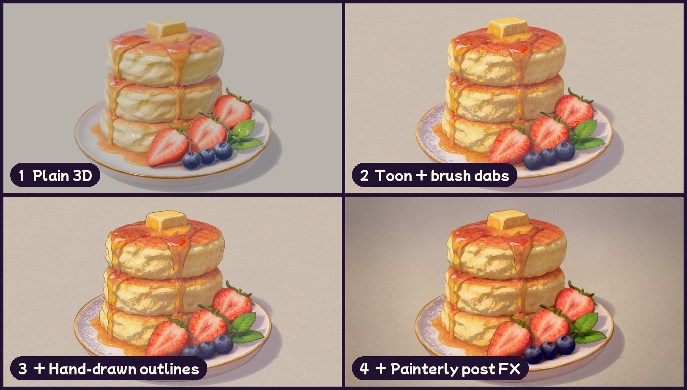

## 🧭 How it works

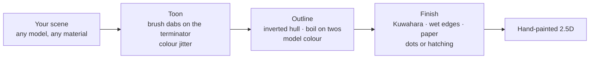

1. **Toon:** Diffuse → Shader to RGB gives the light, divided by the key light's strength for a clean cel split. Near the light/shadow line only, Voronoi brush dabs tilt the normal, and every dab shifts its hue, saturation and value a little.
2. **Outline:** a Geometry Nodes inverted hull with constant screen width, broken by noise and redrawn every two frames.
3. **Finish:** the compositor runs depth fog → two-pass Kuwahara (lines protected) → edge darkening and pigment granulation → dots or hatching in the shadows → bloom → paper → grain → grade. Pixel sizes scale with the resolution.

## 🚀 Get started

### Ask your AI agent (recommended)

Send this to an AI agent that can use your computer, such as Claude Code or Codex:

> Follow AGENTS.md at https://github.com/kanaworksai-hue/painterly-25d to install Painterly 2.5D and make my Blender scene look hand-painted.

Then fix things in plain words while you look at the preview:

- "Make it watercolour"
- "Give it a sunset mood"
- "Show me another version"
- "Bigger brush strokes"
- "Thinner lines"

### Install it yourself

**You need:** Blender 5.0 or later (tested on Blender 5.2) and the EEVEE render engine.

1. Download `painterly_25d-x.y.z.zip` from [Releases](https://github.com/kanaworksai-hue/painterly-25d/releases/latest) (don't unzip it).
2. Blender → Edit → Preferences → Get Extensions → the ⌄ menu at the top right → **Install from Disk…** → pick the zip.


### Use it

1. Open your scene (any model, any materials).
2. In the 3D Viewport press **N** → **Painterly** tab.
3. Click **Make It Painterly**.
4. Pick a **Preset** and a **Medium**. Can't decide? Hit **Shuffle**.
5. Fine-tune in *Toon & Strokes*, *Outline* and *Post FX*, then render with **F12**.

<p align="center">
  
</p>

## 🎛️ What you can tweak

<details>
<summary><b>Main panel</b></summary>

| Option | What it does |
|---|---|
| Preset | Colour and mood (night, golden hour, pastel, day, clean) |
| Medium | Technique (oil, gouache, watercolour, crayon, coloured pencil, anime cel) |
| Variation / Shuffle | A number that re-rolls brush direction, colour jitter, shadow hue, line colour and paper. 0 = off |
| Selected Objects Only | Paint only the selection (default: the whole scene) |
| Add Key Light if Missing | Adds a Sun from the camera side when there is no light (Revert removes it) |
| Fit to Scene Scale | Sets brush, fog and outline fade from object size and camera distance |
| Revert Painterly | Restores the original materials, compositor and view settings |

</details>

<details>
<summary><b>Media</b></summary>

| Medium | Look |
|---|---|
| **Oil Paint** (default) | Thick brush dabs on the light/shadow edge, oil-like Kuwahara paint |
| **Gouache** | Opaque, matte flat paint with soft edges |
| **Watercolour** | Transparent washes: pigment pools at the edges, edges wobble, pigment settles into the paper |
| **Crayon** | Waxy strokes, paper tooth showing through, hatched shadows |
| **Coloured Pencil** | Light shading with cross-hatched shadows |
| **Anime Cel** | Crisp cel shading and lines, no paint texture |

A medium only changes *how* the paint goes on; a preset only changes *colour and mood*, so any combination works.
</details>

<details>
<summary><b>Main detail settings</b></summary>

| Group | Settings |
|---|---|
| Brush dabs | Strength, scale, stretch, distortion, **angle**, terminator band, seed |
| Colour variation | **Colour Jitter** (per dab), **Colour Drift** (large patches) |
| Outline | Thickness, ink colour, **Ink From Object Colour**, hand jitter, boil on twos |
| Medium | **Edge Darkening**, **Wet Wobble**, **Granulation**, **Paper Tooth** |
| Shadow pattern | **Dots / Hatching / Cross-hatching**, amount, spacing, colour |
| Film | Paper, bloom, halation, grain, chromatic aberration, vignette, grade |

Per-object overrides for threshold, shadow value, strokes, glow and outline width are in Object Properties.
</details>

## ❓ FAQ

<details>
<summary><b>Does it work in Cycles?</b></summary>

No. It uses EEVEE's *Shader to RGB* node, so render with EEVEE. **Make It Painterly** switches the scene to EEVEE for you.
</details>

<details>
<summary><b>The brush strokes are too big or too small.</b></summary>

After moving the camera or rescaling the scene, click *Fit to Scene*, then adjust *Stroke Scale* (dabs per metre).
</details>

<details>
<summary><b>Everything is lit and there are no shadows.</b></summary>

Bright worlds and HDRIs add a lot of fill light. Raise *Ambient Compensation*.
</details>

<details>
<summary><b>What happens to my materials?</b></summary>

A toon node group is inserted and the original connection is remembered. *Revert Painterly* puts everything back, and also removes materials and lights the add-on created.
</details>

<details>
<summary><b>Can I use the images and videos commercially?</b></summary>

Yes. Renders and videos you make with Painterly 2.5D are your own work. The GPL covers the add-on's code, not what you make with it (do follow the licences of the models and textures you use). When you publish them, please add `Made with Painterly 2.5D by @KanaWorks_AI` (see [Credit](#-credit)).
</details>

## 📝 Credit

Painterly 2.5D is free, commercial use included. In return, please credit it.

**When you publish images or videos you made with it**, put this in the post, the video description or the credits:

```
Made with Painterly 2.5D by @KanaWorks_AI
```

**When you redistribute, modify or bundle the add-on** (forks, modified versions, ports, packs or products that include it), keeping this line unchanged in the add-on's description and its documentation is **required** (an additional term under GPLv3 section 7(b); see [NOTICE.md](NOTICE.md)):

```
Painterly 2.5D by KanaWorks_AI (@KanaWorks_AI) — https://github.com/kanaworksai-hue/painterly-25d
```

## ⭐ Support with a star

If you like Painterly 2.5D, a **⭐ Star** at the top right of [the repository page](https://github.com/kanaworksai-hue/painterly-25d) means a lot. It's free and takes one second.

- **More people find it:** stars help others discover it on GitHub.
- **More updates:** it keeps new media and presets coming.

Bug reports and feature ideas in [Issues](https://github.com/kanaworksai-hue/painterly-25d/issues), or your renders on X with [@KanaWorks_AI](https://x.com/KanaWorks_AI), are very welcome too.

## 🧩 KanaWorks add-ons

Free, open-source Blender add-ons by the same author. Every one of them can be installed and applied by your AI agent.

<table>
<tr>
<td align="center" width="33%"><a href="https://github.com/kanaworksai-hue/painterly-25d">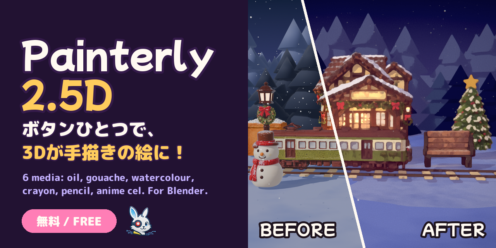</a><br><b>Painterly 2.5D</b> (this page)<br><sub>3D into hand-painted art: oil, watercolour, crayon, anime cel</sub></td>
<td align="center" width="33%"><a href="https://github.com/kanaworksai-hue/kirapaint"></a><br><b><a href="https://github.com/kanaworksai-hue/kirapaint">KiraPaint</a></b><br><sub>Sparkly painterly 2.5D: crushed-diamond gloss and star glints</sub></td>
<td align="center" width="33%"><a href="https://github.com/kanaworksai-hue/mochitoon"></a><br><b><a href="https://github.com/kanaworksai-hue/mochitoon">MochiToon</a></b><br><sub>Cute manga style: coloured shadows, heart and star halftones</sub></td>
</tr>
</table>

## 🛠️ Development

```bash
# headless test (every feature on a scene it was never tuned for)
blender -b --factory-startup --python tests/test_generic.py

# build the installable zip into dist/
BLENDER=blender ./build.sh
```

```
painterly_25d/
  __init__.py      settings, presets / media / variation, operators, panels
  toon.py          toon shader node group (brush dabs, colour jitter, shadow colour)
  outline.py       Geometry Nodes outline and the model-coloured ink material
  post.py          compositor (Kuwahara, wet edges, dots / hatching, paper, grade)
  autosetup.py     make it work on any scene (materials, lights, scale)
  translations.py  Japanese and Simplified Chinese UI
agent/painterly_agent.py  command line for AI agents
```

## 📄 License and credits

- **This add-on:** Copyright © 2026 東京AI映像合同会社 (Tokyo AI Visuals LLC), released under [GPL-3.0-or-later](LICENSE) (with an additional term requiring this attribution when you redistribute it; see [NOTICE.md](NOTICE.md)).
- **Brand:** the KanaWorks_AI name, logo and the character Kana belong to Tokyo AI Visuals LLC and are **not** covered by the GPL. See [docs/brand](docs/brand/README.md).
- Inspired by public NPR breakdowns from the Blender community (Shader to RGB cel shading, Kuwahara compositing, inverted-hull outlines).
- **Blender** is a trademark of the Blender Foundation. This is an independent project, not affiliated with or endorsed by the Blender Foundation.

<br>

<div align="center">

<a href="https://x.com/KanaWorks_AI">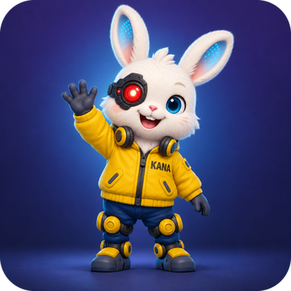</a>

<p><b>Made with ♥ by <a href="https://x.com/KanaWorks_AI">KanaWorks_AI</a></b></p>

<p><sub>If Painterly 2.5D helped you, a ⭐ keeps the updates coming. More projects: <a href="https://github.com/kanaworksai-hue">github.com/kanaworksai-hue</a></sub></p>

</div>
