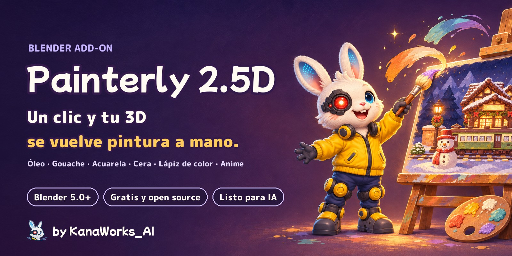
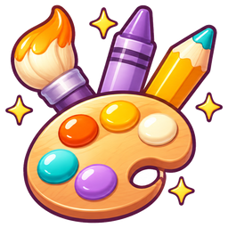
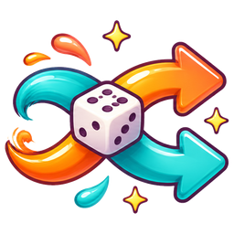
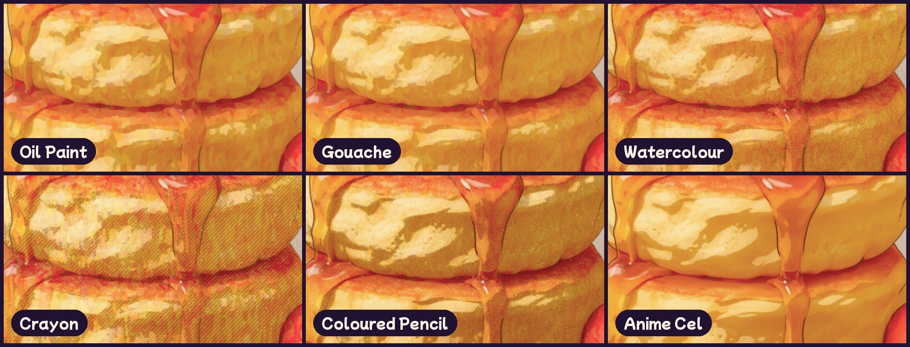
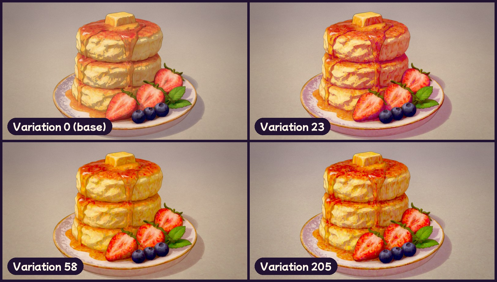
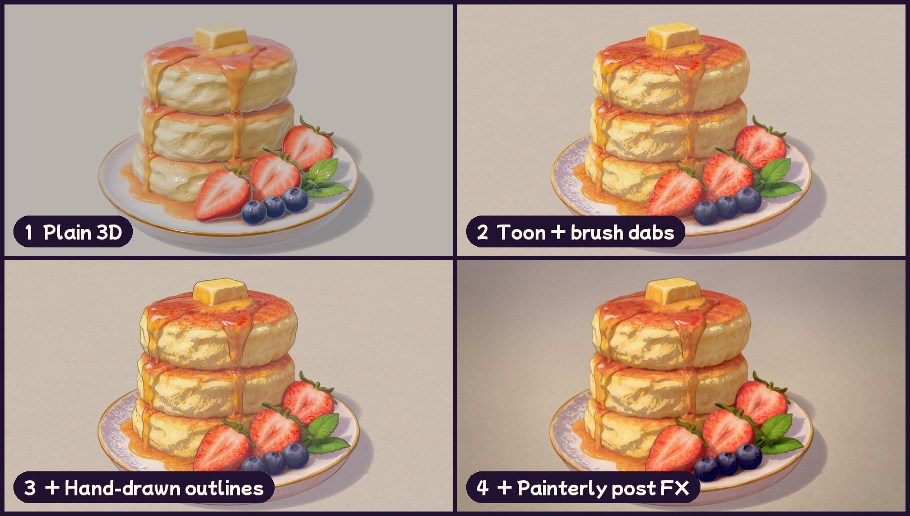
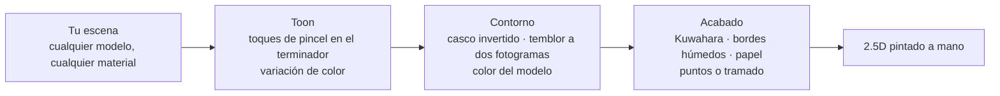
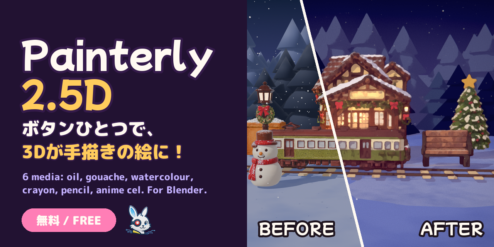

<div align="center">



<p>
  <a href="https://github.com/kanaworksai-hue/painterly-25d/releases/latest"></a>
  
  
  
  
  <a href="LICENSE"></a>
  <a href="NOTICE.md"></a>
  <a href="https://github.com/kanaworksai-hue/painterly-25d/stargazers"></a>
</p>

<p><a href="https://github.com/kanaworksai-hue"></a>&nbsp;<a href="https://github.com/kanaworksai-hue"><b>Un proyecto de KanaWorks_AI</b></a>&nbsp;·&nbsp;<a href="#-add-ons-de-kanaworks">Más add-ons</a></p>

[日本語](README.md) | [English](README.en.md) | [简体中文](README.zh-CN.md) | [한국어](README.ko.md) | [Português](README.pt-BR.md) | **Español**

[🎨 Galería](#-galería) · [🚀 Primeros pasos](#-primeros-pasos) · [🎛️ Qué puedes ajustar](#️-qué-puedes-ajustar) · [❓ Preguntas frecuentes](#-preguntas-frecuentes) · [⭐ Dale una estrella](#-apóyalo-con-una-estrella)

</div>

**Painterly 2.5D** es un add-on gratuito para Blender que convierte cualquier escena en una imagen pintada a mano con un solo clic. De una vez añade sombreado toon con pinceladas solo donde la luz se encuentra con la sombra, contornos dibujados a mano que tiemblan a dos fotogramas y un filtro final de pintura al óleo.

Elige entre **seis técnicas: óleo, gouache, acuarela, ceras, lápices de colores y cel de anime**. Pulsa **Shuffle** y la dirección de las pinceladas y los colores cambian cada vez, así que la misma escena nunca tiene por qué verse igual dos veces. También puedes pedirle a un agente de IA que lo instale y lo aplique por ti con una sola frase.

<p align="center">
  
  <br><sub>Misma escena, misma cámara. Izquierda: un render normal. Derecha: Painterly 2.5D.</sub>
</p>

## ✨ Características

<table>
<tr>
<td align="center" width="25%"><br><b>Un solo clic</b><br><sub>Configura EEVEE, materiales, contornos y el compositor de una sola vez</sub></td>
<td align="center" width="25%"><br><b>Seis técnicas</b><br><sub>Óleo, gouache, acuarela, ceras, lápices de colores, cel de anime</sub></td>
<td align="center" width="25%"><br><b>Shuffle</b><br><sub>Cada clic cambia al azar la dirección del pincel, la variación de color, el tono de las sombras, el color de línea y el papel</sub></td>
<td align="center" width="25%"><br><b>Pídeselo a tu IA</b><br><sub>Una frase a tu agente: instalación, aplicación y vista previa, todo automático</sub></td>
</tr>
</table>

- **Funciona en cualquier escena:** los objetos sin material reciben uno (se conservan los colores de vértice), y se añade una luz principal si la escena no tiene ninguna. Los materiales Diffuse, Emission, de solo imagen y de grupos de nodos mantienen sus colores; el vidrio y las superficies transparentes se dejan tal cual, y también se incluyen las instancias de colección.
- **Se adapta a cualquier escala:** el tamaño del pincel, la niebla de profundidad y el desvanecido de los contornos siguen el tamaño de tus objetos y la distancia de la cámara, así que un producto de 10 cm y un edificio de 50 m se ven bien por igual.
- **Líneas del color del modelo:** los contornos pueden usar un tono más oscuro del propio color de cada objeto (o un único color de tinta para todo).
- **Cinco presets:** Blue-hour Night, Golden Hour, Pastel Sweets, Storybook Day y Clean / Product. Combínalos con cualquier técnica.
- **Reversible:** *Revert Painterly* restaura tus materiales, el compositor y los ajustes de vista. Los ajustes se leen dentro del shader, así que los archivos se renderizan igual aunque no tengas el add-on instalado.
- **Interfaz en English, 日本語 y 简体中文:** sigue lo que tengas en *Preferences › Interface › Translation*.

## 🎨 Galería

### Seis técnicas

Mismo modelo, misma luz. Solo cambia la técnica.



### Shuffle

Cada clic cambia al azar la dirección del pincel, la variación de color, el tono de las sombras, el color de línea y el color del papel, dentro del rango de tu preset y tu técnica. Apunta el número y podrás recuperar ese mismo aspecto cuando quieras.



### Cualquier modelo

Modelos CC0, la propia Suzanne de Blender y modelos de la autora, cada uno con un solo clic.


### Tres capas



## 🧭 Cómo funciona



1. **Toon:** Diffuse → Shader to RGB da la luz, que se divide entre la intensidad de la luz principal para lograr un corte cel limpio. Solo cerca de la línea entre luz y sombra, unos toques de pincel Voronoi inclinan la normal, y cada toque desplaza un poco su tono, saturación y valor.
2. **Contorno:** un casco invertido hecho con Geometry Nodes, de grosor constante en pantalla, roto con ruido y redibujado cada dos fotogramas.
3. **Acabado:** el compositor aplica niebla de profundidad → Kuwahara en dos pasadas (con las líneas protegidas) → oscurecimiento de bordes y granulación del pigmento → puntos o tramado en las sombras → bloom → papel → grano → etalonaje. Los tamaños en píxeles se ajustan a la resolución.

## 🚀 Primeros pasos

### Pídeselo a tu agente de IA (recomendado)

Envía esto a un agente de IA que pueda usar tu ordenador, como Claude Code o Codex:

> Sigue el AGENTS.md de https://github.com/kanaworksai-hue/painterly-25d para instalar Painterly 2.5D y hacer que mi escena de Blender parezca pintada a mano.

Después, ajusta lo que quieras con tus propias palabras mientras miras la vista previa:

- "Hazlo en acuarela"
- "Dale un ambiente de atardecer"
- "Enséñame otra versión"
- "Pinceladas más grandes"
- "Líneas más finas"

### Instálalo tú mismo

**Necesitas:** Blender 5.0 o posterior (probado en Blender 5.2) y el motor de render EEVEE.

1. Descarga `painterly_25d-x.y.z.zip` desde [Releases](https://github.com/kanaworksai-hue/painterly-25d/releases/latest) (no lo descomprimas).
2. Blender → Edit → Preferences → Get Extensions → el menú ⌄ de arriba a la derecha → **Install from Disk…** → elige el zip.


### Úsalo

1. Abre tu escena (cualquier modelo, cualquier material).
2. En el 3D Viewport pulsa **N** → pestaña **Painterly**.
3. Haz clic en **Make It Painterly**.
4. Elige un **Preset** y un **Medium**. ¿No te decides? Pulsa **Shuffle**.
5. Afina los detalles en *Toon & Strokes*, *Outline* y *Post FX*, y renderiza con **F12**.

<p align="center">
  
</p>

## 🎛️ Qué puedes ajustar

<details>
<summary><b>Panel principal</b></summary>

| Opción | Qué hace |
|---|---|
| Preset | Color y ambiente (noche, hora dorada, pastel, día, limpio) |
| Medium | Técnica (óleo, gouache, acuarela, ceras, lápices de colores, cel de anime) |
| Variation / Shuffle | Un número que vuelve a sortear la dirección del pincel, la variación de color, el tono de las sombras, el color de línea y el papel. 0 = desactivado |
| Selected Objects Only | Pinta solo la selección (por defecto: toda la escena) |
| Add Key Light if Missing | Añade un Sun desde el lado de la cámara si no hay ninguna luz (Revert lo elimina) |
| Fit to Scene Scale | Ajusta el pincel, la niebla y el desvanecido de los contornos según el tamaño de los objetos y la distancia de la cámara |
| Revert Painterly | Restaura los materiales originales, el compositor y los ajustes de vista |

</details>

<details>
<summary><b>Técnicas</b></summary>

| Medium | Aspecto |
|---|---|
| **Oil Paint** (por defecto) | Toques de pincel gruesos en el borde entre luz y sombra, pintura tipo óleo con Kuwahara |
| **Gouache** | Pintura plana, opaca y mate, con bordes suaves |
| **Watercolour** | Aguadas transparentes: el pigmento se acumula en los bordes, los bordes ondulan y el pigmento se asienta en el papel |
| **Crayon** | Trazos cerosos, con la textura del papel asomando y sombras tramadas |
| **Coloured Pencil** | Sombreado ligero con sombras de trama cruzada |
| **Anime Cel** | Sombreado cel y líneas nítidas, sin textura de pintura |

Una técnica solo cambia *cómo* se aplica la pintura; un preset solo cambia *el color y el ambiente*, así que cualquier combinación funciona.
</details>

<details>
<summary><b>Principales ajustes de detalle</b></summary>

| Grupo | Ajustes |
|---|---|
| Toques de pincel | Intensidad, escala, estiramiento, distorsión, **ángulo**, banda del terminador, semilla |
| Variación de color | **Colour Jitter** (por toque), **Colour Drift** (manchas grandes) |
| Contorno | Grosor, color de tinta, **Ink From Object Colour**, temblor de mano, temblor a dos fotogramas |
| Técnica | **Edge Darkening**, **Wet Wobble**, **Granulation**, **Paper Tooth** |
| Patrón de sombra | **Dots / Hatching / Cross-hatching**, cantidad, espaciado, color |
| Película | Papel, bloom, halación, grano, aberración cromática, viñeta, etalonaje |

En Object Properties puedes sobrescribir por objeto el umbral, el valor de sombra, las pinceladas, el brillo y el grosor del contorno.
</details>

## ❓ Preguntas frecuentes

<details>
<summary><b>¿Funciona en Cycles?</b></summary>

No. Usa el nodo *Shader to RGB* de EEVEE, así que renderiza con EEVEE. **Make It Painterly** cambia la escena a EEVEE por ti.
</details>

<details>
<summary><b>Las pinceladas son demasiado grandes o demasiado pequeñas.</b></summary>

Después de mover la cámara o cambiar la escala de la escena, haz clic en *Fit to Scene* y luego ajusta *Stroke Scale* (toques por metro).
</details>

<details>
<summary><b>Todo está iluminado y no hay sombras.</b></summary>

Los fondos (World) muy luminosos y los HDRI añaden mucha luz de relleno. Sube *Ambient Compensation*.
</details>

<details>
<summary><b>¿Qué pasa con mis materiales?</b></summary>

Se inserta un grupo de nodos toon y se recuerda la conexión original. *Revert Painterly* lo deja todo como estaba y además elimina los materiales y las luces que creó el add-on.
</details>

<details>
<summary><b>¿Puedo usar las imágenes y los vídeos con fines comerciales?</b></summary>

Sí. Los renders y vídeos que hagas con Painterly 2.5D son obra tuya. La GPL cubre el código del add-on, no lo que creas con él (eso sí, respeta las licencias de los modelos y texturas que uses). No hace falta dar créditos, pero `Made with Painterly 2.5D by @KanaWorks_AI` siempre es bienvenido.
</details>

## 📝 Créditos

Painterly 2.5D es gratis, también para uso comercial.

**Cuando redistribuyas, modifiques o incluyas el add-on en otro producto** (forks, versiones modificadas, ports, packs o productos que lo incluyan, gratis o de pago), es **obligatorio** mantener esta línea, sin cambios, en la descripción del add-on y en su documentación (término adicional de la sección 7(b) de la GPLv3; consulta [NOTICE.md](NOTICE.md)):

```
Painterly 2.5D by KanaWorks_AI (@KanaWorks_AI) — https://github.com/kanaworksai-hue/painterly-25d
```

**Las imágenes y vídeos que hagas** no necesitan créditos. Si quieres añadirlos, esta línea en la publicación o la descripción es muy bienvenida:

```
Made with Painterly 2.5D by @KanaWorks_AI
```

## ⭐ Apóyalo con una estrella

Si te gusta Painterly 2.5D, una **⭐ Star** arriba a la derecha de [la página del repositorio](https://github.com/kanaworksai-hue/painterly-25d) significa muchísimo. Es gratis y lleva un segundo.

- **Lo descubre más gente:** las estrellas ayudan a que otros lo encuentren en GitHub.
- **Más actualizaciones:** anima a seguir sacando nuevas técnicas y presets.

También son muy bienvenidos los reportes de errores y las ideas en [Issues](https://github.com/kanaworksai-hue/painterly-25d/issues), o que compartas tus renders en X con [@KanaWorks_AI](https://x.com/KanaWorks_AI).

## 🧩 Add-ons de KanaWorks

Add-ons gratuitos y de código abierto para Blender, de la misma autora. Tu agente de IA puede instalar y aplicar cualquiera de ellos.

<table>
<tr>
<td align="center" width="33%"><a href="https://github.com/kanaworksai-hue/painterly-25d"></a><br><b>Painterly 2.5D</b> (esta página)<br><sub>Del 3D al arte pintado a mano: óleo, acuarela, ceras, cel de anime</sub></td>
<td align="center" width="33%"><a href="https://github.com/kanaworksai-hue/kirapaint"></a><br><b><a href="https://github.com/kanaworksai-hue/kirapaint">KiraPaint</a></b><br><sub>2.5D pictórico con brillo: destellos de diamante triturado y chispas de estrella</sub></td>
<td align="center" width="33%"><a href="https://github.com/kanaworksai-hue/mochitoon"></a><br><b><a href="https://github.com/kanaworksai-hue/mochitoon">MochiToon</a></b><br><sub>Estilo manga adorable: sombras de color, semitonos de corazones y estrellas</sub></td>
</tr>
</table>

## 🛠️ Desarrollo

```bash
# prueba sin interfaz (todas las funciones en una escena para la que nunca se ajustó)
blender -b --factory-startup --python tests/test_generic.py

# genera el zip instalable en dist/
BLENDER=blender ./build.sh
```

```
painterly_25d/
  __init__.py      ajustes, presets / técnicas / variación, operadores, paneles
  toon.py          grupo de nodos del shader toon (toques de pincel, variación de color, color de sombra)
  outline.py       contorno con Geometry Nodes y material de tinta del color del modelo
  post.py          compositor (Kuwahara, bordes húmedos, puntos / tramado, papel, etalonaje)
  autosetup.py     hace que funcione en cualquier escena (materiales, luces, escala)
  translations.py  interfaz en japonés y chino simplificado
agent/painterly_agent.py  línea de comandos para agentes de IA
```

## 📄 Licencia y créditos

- **Este add-on:** Copyright © 2026 東京AI映像合同会社 (Tokyo AI Visuals LLC), publicado bajo [GPL-3.0-or-later](LICENSE) (con un término adicional que exige esta atribución al redistribuirlo; consulta [NOTICE.md](NOTICE.md)).
- **Marca:** el nombre KanaWorks_AI, el logotipo y el personaje Kana pertenecen a Tokyo AI Visuals LLC y **no** están cubiertos por la GPL. Consulta [docs/brand](docs/brand/README.md).
- Inspirado en análisis públicos de NPR de la comunidad de Blender (sombreado cel con Shader to RGB, composición con Kuwahara, contornos de casco invertido).
- **Blender** es una marca registrada de la Blender Foundation. Este es un proyecto independiente, sin afiliación ni respaldo de la Blender Foundation.

<br>

<div align="center">

<a href="https://x.com/KanaWorks_AI"></a>

<p><b>Hecho con ♥ por <a href="https://x.com/KanaWorks_AI">KanaWorks_AI</a></b></p>

<p><sub>Si Painterly 2.5D te ha sido útil, una ⭐ mantiene vivas las actualizaciones. Más proyectos: <a href="https://github.com/kanaworksai-hue">github.com/kanaworksai-hue</a></sub></p>

</div>
