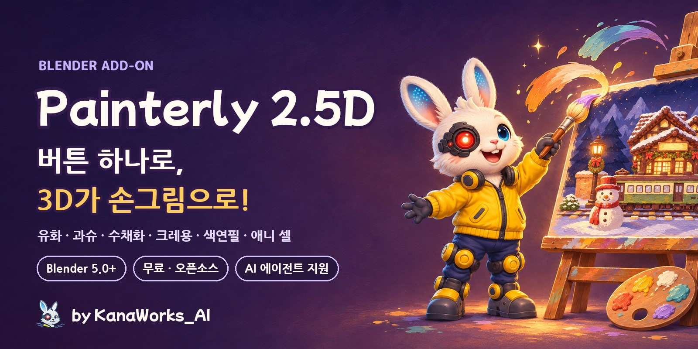
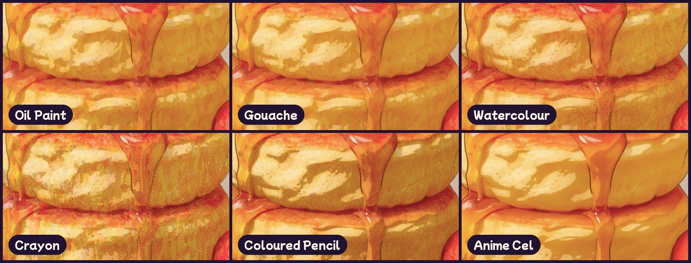
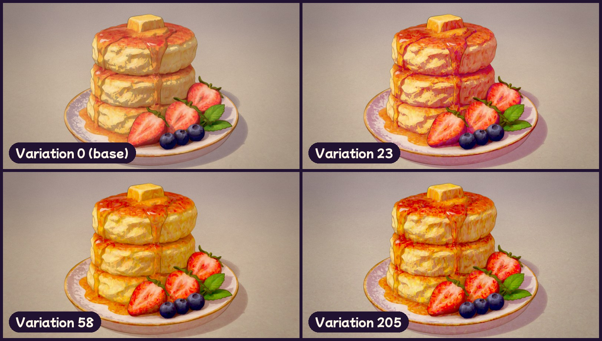
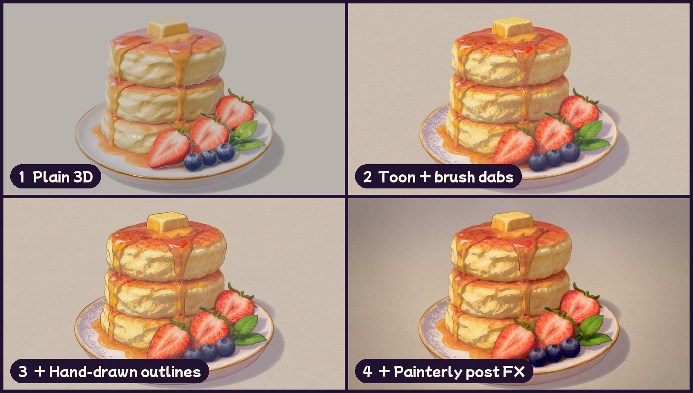
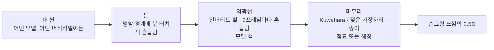
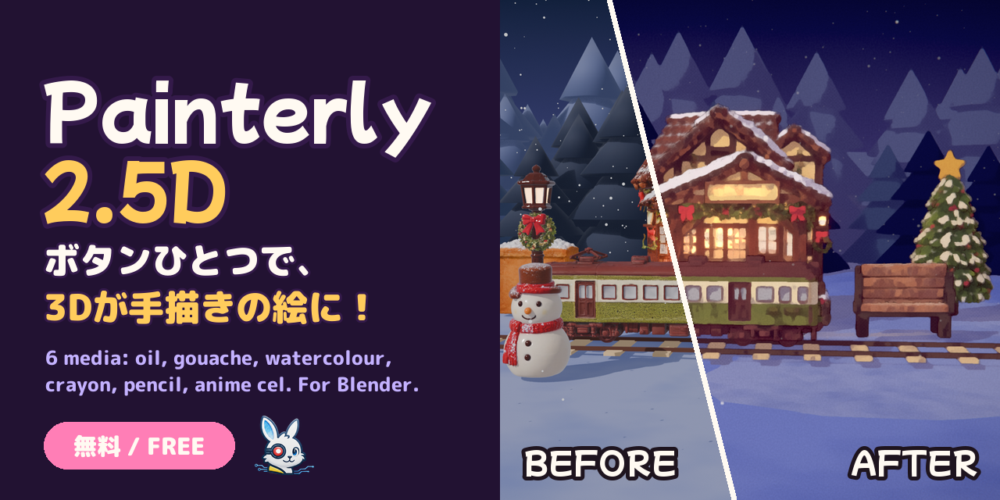

<div align="center">



<p>
  <a href="https://github.com/kanaworksai-hue/painterly-25d/releases/latest"></a>
  
  
  
  
  <a href="LICENSE"></a>
  <a href="NOTICE.md"></a>
  <a href="https://github.com/kanaworksai-hue/painterly-25d/stargazers"></a>
</p>

<p><a href="https://github.com/kanaworksai-hue"></a>&nbsp;<a href="https://github.com/kanaworksai-hue"><b>A KanaWorks_AI project</b></a>&nbsp;·&nbsp;<a href="#-kanaworks-애드온">다른 애드온 보기</a></p>

[日本語](README.md) | [English](README.en.md) | [简体中文](README.zh-CN.md) | **한국어** | [Português](README.pt-BR.md) | [Español](README.es.md)

[🎨 갤러리](#-갤러리) · [🚀 시작하기](#-시작하기) · [🎛️ 조정할 수 있는 항목](#️-조정할-수-있는-항목) · [❓ 자주 묻는 질문](#-자주-묻는-질문) · [⭐ 스타 누르기](#-스타로-응원하기)

</div>

**Painterly 2.5D**는 어떤 씬이든 클릭 한 번으로 손으로 그린 그림처럼 바꿔 주는 무료 Blender 애드온입니다. 빛과 그림자의 경계에만 붓 터치가 들어가는 툰 셰이딩, 2프레임마다 살짝 흔들리는 손그림 느낌의 외곽선, 유화풍 마무리 필터를 한 번에 적용해요.

**유화, 과슈, 수채화, 크레용, 색연필, 애니메이션 셀** 이렇게 **6가지 화풍**(Medium) 중에서 고를 수 있어요. **Shuffle**(셔플)을 누르면 붓 방향과 색감이 매번 바뀌어서, 같은 씬이라도 늘 새로운 그림을 얻을 수 있습니다. AI 에이전트에게 한 문장만 보내면 설치부터 적용까지 알아서 해 주기도 해요.

<p align="center">
  
  <br><sub>같은 씬, 같은 카메라. 왼쪽은 일반 렌더, 오른쪽은 Painterly 2.5D를 적용한 결과예요.</sub>
</p>

## ✨ 주요 기능

<table>
<tr>
<td align="center" width="25%"><br><b>클릭 한 번</b><br><sub>EEVEE, 머티리얼, 외곽선, 컴포지터를 한 번에 세팅</sub></td>
<td align="center" width="25%"><br><b>6가지 화풍</b><br><sub>유화, 과슈, 수채화, 크레용, 색연필, 애니메이션 셀</sub></td>
<td align="center" width="25%"><br><b>Shuffle</b><br><sub>누를 때마다 붓 방향, 색 흔들림, 그림자 색조, 선 색, 종이가 새로 바뀜</sub></td>
<td align="center" width="25%"><br><b>AI에게 맡기기</b><br><sub>에이전트에게 한 문장만 보내면 설치, 적용, 미리보기까지 자동</sub></td>
</tr>
</table>

- **어떤 씬에서도 동작:** 머티리얼이 없는 오브젝트에는 새로 만들어 주고(버텍스 컬러는 그대로 유지), 씬에 조명이 없으면 키 라이트를 추가해요. Diffuse, Emission, 이미지만 연결된 머티리얼, 노드 그룹 머티리얼도 원래 색을 유지하고, 유리나 투명한 표면은 건드리지 않으며, 컬렉션 인스턴스도 함께 처리합니다.
- **어떤 스케일에도 대응:** 붓 크기, 깊이 안개, 외곽선 페이드가 오브젝트 크기와 카메라 거리에 맞춰 자동으로 조정돼요. 10cm짜리 제품도, 50m짜리 건물도 자연스럽게 나옵니다.
- **모델 색을 살린 선:** 외곽선을 각 오브젝트 고유색의 어두운 톤으로 그릴 수 있어요(모든 선을 같은 잉크색으로 통일할 수도 있습니다).
- **프리셋 5종:** Blue-hour Night, Golden Hour, Pastel Sweets, Storybook Day, Clean / Product. 어떤 화풍과도 조합할 수 있어요.
- **언제든 되돌리기:** *Revert Painterly*를 누르면 머티리얼, 컴포지터, 뷰 설정이 원래대로 돌아옵니다. 설정값은 셰이더 안에서 읽어 오기 때문에, 애드온이 설치되지 않은 환경에서도 똑같이 렌더링돼요.
- **UI는 English, 日本語, 简体中文 지원:** *Preferences › Interface › Translation* 설정을 따릅니다.

## 🎨 갤러리

### 6가지 화풍

같은 모델, 같은 조명. 화풍만 바꿨어요.



### Shuffle

누를 때마다 프리셋과 화풍의 범위 안에서 붓 방향, 색 흔들림, 그림자 색조, 선 색, 종이 색이 무작위로 바뀝니다. 마음에 드는 번호를 적어 두면 언제든 같은 결과를 다시 불러올 수 있어요.



### 어떤 모델이든

CC0 모델, Blender 기본 모델인 Suzanne, 제작자의 모델까지 모두 클릭 한 번으로 적용했어요.


### 3개의 레이어



## 🧭 작동 방식



1. **툰:** Diffuse → Shader to RGB로 빛을 얻고, 키 라이트의 강도로 나눠서 깔끔한 셀 분할을 만듭니다. 명암 경계 근처에서만 Voronoi 붓 터치가 노멀을 기울이고, 터치마다 색상, 채도, 명도가 조금씩 달라져요.
2. **외곽선:** Geometry Nodes로 만든 인버티드 헐(inverted hull)이에요. 화면상 두께가 일정하고, 노이즈로 선이 끊기며, 2프레임마다 다시 그려집니다.
3. **마무리:** 컴포지터에서 깊이 안개 → 2패스 Kuwahara(선은 보호) → 가장자리 어둡게 하기와 안료 입자 표현 → 그림자에 점묘 또는 해칭 → 블룸 → 종이 → 그레인 → 색 보정 순서로 처리해요. 픽셀 단위 크기는 해상도에 맞춰 조정됩니다.

## 🚀 시작하기

### AI 에이전트에게 맡기기 (추천)

Claude Code나 Codex처럼 컴퓨터를 조작할 수 있는 AI 에이전트에게 이렇게 보내 보세요.

> https://github.com/kanaworksai-hue/painterly-25d 의 AGENTS.md를 따라서 Painterly 2.5D를 설치하고, 내 Blender 씬을 손그림 느낌으로 만들어 줘.

그다음엔 미리보기를 보면서 평소 말투로 수정을 요청하면 돼요.

- "수채화로 바꿔 줘"
- "노을 지는 분위기로 해 줘"
- "다른 버전도 보여 줘"
- "붓 터치를 더 크게"
- "선을 더 가늘게"

### 직접 설치하기

**필요한 것:** Blender 5.0 이상(Blender 5.2에서 테스트됨), EEVEE 렌더 엔진.

1. [Releases](https://github.com/kanaworksai-hue/painterly-25d/releases/latest)에서 `painterly_25d-x.y.z.zip`을 내려받으세요(압축은 풀지 마세요).
2. Blender → Edit → Preferences → Get Extensions → 오른쪽 위 ⌄ 메뉴 → **Install from Disk…** → zip 파일을 선택합니다.


### 사용 방법

1. 씬을 엽니다(어떤 모델, 어떤 머티리얼이든 괜찮아요).
2. 3D 뷰포트에서 **N** 키를 누르고 → **Painterly** 탭을 엽니다.
3. **Make It Painterly**를 클릭합니다.
4. **Preset**(프리셋)과 **Medium**(화풍)을 고릅니다. 고민된다면 **Shuffle**을 눌러 보세요.
5. *Toon & Strokes*, *Outline*, *Post FX*에서 세부 조정을 한 뒤 **F12**로 렌더링합니다.

<p align="center">
  
</p>

## 🎛️ 조정할 수 있는 항목

<details>
<summary><b>메인 패널</b></summary>

| 옵션 | 설명 |
|---|---|
| Preset | 색감과 분위기(밤, 골든 아워, 파스텔, 낮, 클린) |
| Medium | 화풍(유화, 과슈, 수채화, 크레용, 색연필, 애니메이션 셀) |
| Variation / Shuffle | 붓 방향, 색 흔들림, 그림자 색조, 선 색, 종이를 새로 뽑는 번호. 0이면 꺼짐 |
| Selected Objects Only | 선택한 오브젝트에만 적용(기본값: 씬 전체) |
| Add Key Light if Missing | 조명이 없으면 카메라 쪽에서 비추는 Sun 라이트를 추가(Revert하면 삭제됨) |
| Fit to Scene Scale | 오브젝트 크기와 카메라 거리를 바탕으로 붓, 안개, 외곽선 페이드를 설정 |
| Revert Painterly | 원래 머티리얼, 컴포지터, 뷰 설정으로 되돌리기 |

</details>

<details>
<summary><b>화풍(Medium)</b></summary>

| 화풍 | 느낌 |
|---|---|
| **Oil Paint** (기본값) | 명암 경계에 두툼한 붓 터치, 유화 같은 Kuwahara 질감 |
| **Gouache** | 불투명하고 매트한 평면 채색, 부드러운 가장자리 |
| **Watercolour** | 투명한 번짐: 가장자리에 물감이 고이고, 경계가 흔들리며, 안료가 종이 결에 내려앉음 |
| **Crayon** | 왁스 같은 터치, 종이 결이 비쳐 보이고 그림자는 해칭 |
| **Coloured Pencil** | 가벼운 음영과 크로스 해칭 그림자 |
| **Anime Cel** | 선명한 셀 셰이딩과 선, 물감 질감 없음 |

화풍은 물감을 *어떻게* 칠할지만, 프리셋은 *색감과 분위기*만 바꾸기 때문에 어떤 조합이든 자유롭게 쓸 수 있어요.
</details>

<details>
<summary><b>주요 세부 설정</b></summary>

| 그룹 | 설정 |
|---|---|
| 붓 터치 | 강도, 크기, 늘이기, 왜곡, **각도**, 명암 경계 폭, 시드 |
| 색 변화 | **Colour Jitter**(터치마다), **Colour Drift**(큰 영역 단위) |
| 외곽선 | 두께, 잉크 색, **Ink From Object Colour**, 손 떨림, 2프레임 흔들림 |
| 화풍 | **Edge Darkening**, **Wet Wobble**, **Granulation**, **Paper Tooth** |
| 그림자 패턴 | **Dots / Hatching / Cross-hatching**, 양, 간격, 색 |
| 필름 | 종이, 블룸, 할레이션, 그레인, 색수차, 비네트, 색 보정 |

임계값, 그림자 명도, 붓 터치, 발광, 외곽선 두께는 Object Properties에서 오브젝트별로 따로 설정할 수 있어요.
</details>

## ❓ 자주 묻는 질문

<details>
<summary><b>Cycles에서도 쓸 수 있나요?</b></summary>

아니요. EEVEE의 *Shader to RGB* 노드를 사용하기 때문에 EEVEE로 렌더링해야 해요. **Make It Painterly**를 누르면 씬이 자동으로 EEVEE로 전환됩니다.
</details>

<details>
<summary><b>붓 터치가 너무 크거나 작아요.</b></summary>

카메라를 옮겼거나 씬 스케일을 바꿨다면 *Fit to Scene*을 클릭한 뒤 *Stroke Scale*(1미터당 터치 수)을 조정해 보세요.
</details>

<details>
<summary><b>전체가 다 밝고 그림자가 안 생겨요.</b></summary>

밝은 World나 HDRI는 보조광이 많이 들어가요. *Ambient Compensation* 값을 올려 보세요.
</details>

<details>
<summary><b>원래 머티리얼은 어떻게 되나요?</b></summary>

툰 노드 그룹이 끼워 넣어지고, 원래 연결 상태는 따로 기억해 둡니다. *Revert Painterly*를 누르면 모두 원래대로 돌아오고, 애드온이 만든 머티리얼과 조명도 함께 삭제돼요.
</details>

<details>
<summary><b>만든 이미지나 영상을 상업적으로 써도 되나요?</b></summary>

네. Painterly 2.5D로 만든 렌더 이미지와 영상은 여러분의 작품이에요. GPL은 애드온 코드에만 적용되고, 애드온으로 만든 결과물에는 적용되지 않습니다(사용한 모델과 텍스처의 라이선스는 꼭 지켜 주세요). 공개할 때는 `Made with Painterly 2.5D by @KanaWorks_AI`를 넣어 주세요([크레딧 표기](#-크레딧-표기)).
</details>

## 📝 크레딧 표기

Painterly 2.5D는 무료이고 상업적으로도 쓸 수 있어요. 대신 크레딧 표기를 부탁드려요.

**만든 이미지나 영상을 공개할 때**는 게시글, 영상 설명란 또는 크레딧에 넣어 주세요.

```
Made with Painterly 2.5D by @KanaWorks_AI
```

**애드온을 재배포·수정·번들할 때**(포크, 수정판, 이식판, 이 애드온이 포함된 팩이나 제품 등)는 아래 문구를 애드온 설명과 문서에 그대로 남기는 것이 **필수**입니다(GPL-3.0 제7조 (b)에 따른 추가 조항, 자세한 내용은 [NOTICE.md](NOTICE.md)).

```
Painterly 2.5D by KanaWorks_AI (@KanaWorks_AI) — https://github.com/kanaworksai-hue/painterly-25d
```

## ⭐ 스타로 응원하기

Painterly 2.5D가 마음에 드셨다면 [저장소 페이지](https://github.com/kanaworksai-hue/painterly-25d) 오른쪽 위의 **⭐ Star**를 눌러 주세요. 무료이고 1초면 충분하지만, 저에게는 큰 힘이 돼요.

- **더 많은 사람에게 닿아요:** 스타가 많을수록 GitHub에서 다른 사람들이 발견하기 쉬워집니다.
- **업데이트가 계속돼요:** 새로운 화풍과 프리셋을 계속 만들어 갈 원동력이 됩니다.

버그 제보나 기능 아이디어는 [Issues](https://github.com/kanaworksai-hue/painterly-25d/issues)에, 렌더 작품은 X에서 [@KanaWorks_AI](https://x.com/KanaWorks_AI)를 태그해서 공유해 주시면 정말 기쁠 거예요.

## 🧩 KanaWorks 애드온

같은 제작자가 만든 무료 오픈소스 Blender 애드온이에요. 모두 AI 에이전트가 설치부터 적용까지 해 줄 수 있습니다.

<table>
<tr>
<td align="center" width="33%"><a href="https://github.com/kanaworksai-hue/painterly-25d"></a><br><b>Painterly 2.5D</b> (이 페이지)<br><sub>3D를 손그림으로: 유화, 수채화, 크레용, 애니메이션 셀</sub></td>
<td align="center" width="33%"><a href="https://github.com/kanaworksai-hue/kirapaint"></a><br><b><a href="https://github.com/kanaworksai-hue/kirapaint">KiraPaint</a></b><br><sub>반짝이는 회화풍 2.5D: 다이아몬드 가루 같은 광택과 별빛 반짝임</sub></td>
<td align="center" width="33%"><a href="https://github.com/kanaworksai-hue/mochitoon"></a><br><b><a href="https://github.com/kanaworksai-hue/mochitoon">MochiToon</a></b><br><sub>귀여운 만화풍: 컬러 그림자, 하트와 별 모양 하프톤</sub></td>
</tr>
</table>

## 🛠️ 개발

```bash
# headless test (every feature on a scene it was never tuned for)
blender -b --factory-startup --python tests/test_generic.py

# build the installable zip into dist/
BLENDER=blender ./build.sh
```

```
painterly_25d/
  __init__.py      settings, presets / media / variation, operators, panels
  toon.py          toon shader node group (brush dabs, colour jitter, shadow colour)
  outline.py       Geometry Nodes outline and the model-coloured ink material
  post.py          compositor (Kuwahara, wet edges, dots / hatching, paper, grade)
  autosetup.py     make it work on any scene (materials, lights, scale)
  translations.py  Japanese and Simplified Chinese UI
agent/painterly_agent.py  command line for AI agents
```

## 📄 라이선스 및 크레딧

- **이 애드온:** Copyright © 2026 東京AI映像合同会社 (Tokyo AI Visuals LLC), [GPL-3.0-or-later](LICENSE)로 배포합니다 (재배포 시 크레딧 표기를 요구하는 추가 조항 포함, [NOTICE.md](NOTICE.md)).
- **브랜드:** KanaWorks_AI라는 이름과 로고, 캐릭터 Kana는 Tokyo AI Visuals LLC의 소유이며 GPL 적용 대상이 **아닙니다**. 자세한 내용은 [docs/brand](docs/brand/README.md)를 참고하세요.
- Blender 커뮤니티에 공개된 NPR 기법 해설(Shader to RGB 셀 셰이딩, Kuwahara 컴포지팅, 인버티드 헐 외곽선)에서 영감을 받았습니다.
- **Blender**는 Blender Foundation의 상표입니다. 이 프로젝트는 독립 프로젝트이며, Blender Foundation과 제휴하거나 보증을 받은 것이 아닙니다.

<br>

<div align="center">

<a href="https://x.com/KanaWorks_AI"></a>

<p><b>Made with ♥ by <a href="https://x.com/KanaWorks_AI">KanaWorks_AI</a></b></p>

<p><sub>Painterly 2.5D가 도움이 되었다면 ⭐ 하나가 업데이트를 이어 가는 힘이 됩니다. 다른 프로젝트: <a href="https://github.com/kanaworksai-hue">github.com/kanaworksai-hue</a></sub></p>

</div>
