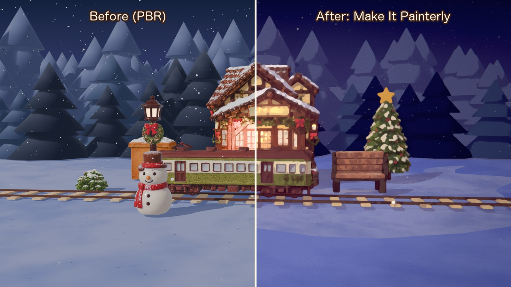
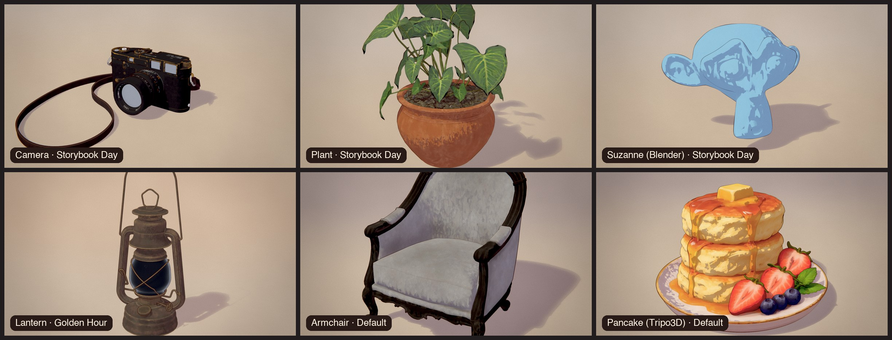
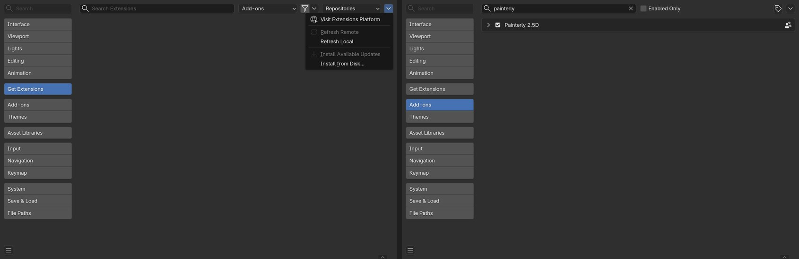
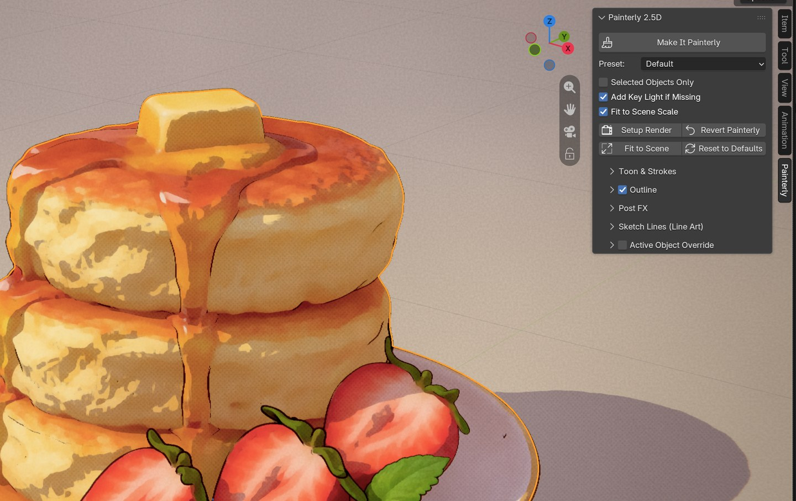

# Painterly 2.5D

**One-click hand-painted 2.5D look for Blender 5 (EEVEE).** Toon shading with brush dabs on the light/shadow edge, hand-drawn outlines that boil on twos, and an oil-paint post effect, all applied to any scene with a single button.

English | [日本語](README.ja.md) | [简体中文](README.zh-CN.md)



## Features

- **Make It Painterly**: one button sets up EEVEE, converts every material to the painterly toon shader, adds outlines and builds the compositor.
- **Works on any scene**
  - Objects without materials get one automatically, and vertex colours are kept.
  - Diffuse, Emission, image-only and node-group materials keep their colours.
  - Glass and alpha-blended surfaces keep their original shader.
  - Collection instances (Asset Browser / linked assets) are included.
  - The strongest Sun (or the point/spot/area light that lights your subject most) is used as the key; if the scene has no light at all, a Sun is added, aimed from the camera side.
  - *Fit to Scene* sets the brush-dab size, depth fog and outline fade from your object size and camera distance, so a 10 cm product and a 50 m building both look right.
  - *Ambient Compensation* keeps the light/shadow split working under bright skies and HDRIs.
- **Toon & strokes**
  - Cel shading normalised to the key light.
  - Coloured shadows derived from the albedo (HSV).
  - Brush dabs only near the terminator.
  - Rim light and texture glow (windows, lanterns).
- **Outlines**
  - Geometry Nodes inverted hull with constant screen width.
  - Distance fade, broken hand-drawn width and boil on twos.
  - UV seams are welded automatically, and flat ground planes are skipped.
- **Post FX**: depth fog, two-pass Kuwahara with ink protection, texture dots in shadows, warm bloom and halation, paper, sensor dust, grain, chromatic aberration, vignette and a vintage grade. All pixel sizes scale with resolution.
- **Presets**:
  - Blue-hour Night
  - Golden Hour
  - Pastel Sweets
  - Storybook Day
  - Clean / Product

  Each preset changes only its own keys.
- **Per-object overrides** for threshold, shadow value, strokes, glow and outline width. These work even when objects share a material.
- **Safe and reversible**: settings are read inside the shader (no per-frame handlers), so it's render-farm friendly. Baked fallbacks (from the scene that was active when you saved) keep files rendering the same without the add-on. **Revert Painterly** restores the original materials, compositor and view settings.
- **UI in English, 日本語 and 简体中文**: it follows *Preferences › Interface › Translation*.



## Install

1. Download `painterly_25d-x.y.z.zip` from [Releases](../../releases). Don't unzip it.
2. In Blender 5.0+, open **Edit › Preferences › Get Extensions**, click the **⌄** menu at the top right and choose **Install from Disk…**.
3. Select the zip. The add-on is enabled straight away.



## Quick start

1. Open your scene (any model, any materials).
2. In the 3D Viewport, press **N** and open the **Painterly** tab.
3. Click **Make It Painterly**. The viewport switches to Rendered with the compositor on.
4. Pick a **Preset**, then fine-tune in *Toon & Strokes*, *Outline* and *Post FX*.
5. Render with **F12** (EEVEE).



| Option | What it does |
|---|---|
| Selected Objects Only | Make It Painterly converts only the selection (default: the whole visible scene). Materials shared with unselected objects change on those objects too |
| Add Key Light if Missing | Adds `P25D Key Sun` when the scene has no light (Revert Painterly removes it) |
| Fit to Scene Scale | Sets dab size / fog / outline fade from object size and camera distance |
| Fit to Scene (button) | Re-runs the fit after you move the camera or rescale the scene |
| Revert Painterly | Restores original materials, removes outlines, restores compositor, render engine and view settings (whole scene, or the selection when *Selected Objects Only* is on) |
| Reset to Defaults | Resets every look setting |

### Tips

- **Dabs too big or too small?** Use *Fit to Scene*, then adjust *Stroke Scale* (dabs per metre).
- **Everything lit, no shadows?** Raise *Ambient Compensation* (bright worlds and HDRIs add fill light).
- **Product turntables**: the *Clean / Product* preset keeps the paint subtle.
- **Lines on one object too thick?** Turn on *Override* in Object Properties and lower *Outline Width x*.
- **Windows and lanterns**: raise *Texture Glow* (scene-wide or per object).

## How it works

```
Material  : Diffuse → Shader to RGB → (irradiance − ambient) / key strength → cel ramp
            + Voronoi brush-dab normals near the terminator + HSV shadow colour from the albedo
Outline   : Geometry Nodes inverted hull, width ∝ camera distance (constant on screen),
            noise-broken width, boil = floor(frame / rate)
Compositor: fog → Kuwahara ×2 (ink protected via AOV) → shadow dots → bloom/halation
            → paper → dust → grain → aberration → vignette → grade
```

All look settings live on the scene (`scene.p25d`) and on each object (`object.p25d_obj`). The shader reads them with Attribute nodes, so shared materials stay correct, undo is safe, and nothing is pushed into materials from Python.

## Limitations

- EEVEE only (Shader to RGB isn't supported in Cycles).
- Outlines are added to mesh objects. Curves and text get the toon material but no outline (convert them to mesh for outlines).
- Sketch Lines (Line Art) is heavy on dense scenes; bake it for animation.

## Development

```sh
./build.sh                                                          # validate + build dist/painterly_25d-x.y.z.zip
blender -b --factory-startup --python tests/test_generic.py         # headless test on a scene it was never tuned for
```

## Credits

- Inspired by public NPR breakdowns: "Shader to RGB" cel workflows, Kuwahara compositing and inverted-hull outlines shared by the Blender community.
- Showcase models from [Poly Haven](https://polyhaven.com) (CC0) and models made with [Tripo3D](https://www.tripo3d.ai).
- Made by Tokyo AI Visuals.

## License

[GPL-3.0-or-later](LICENSE), like Blender itself.
