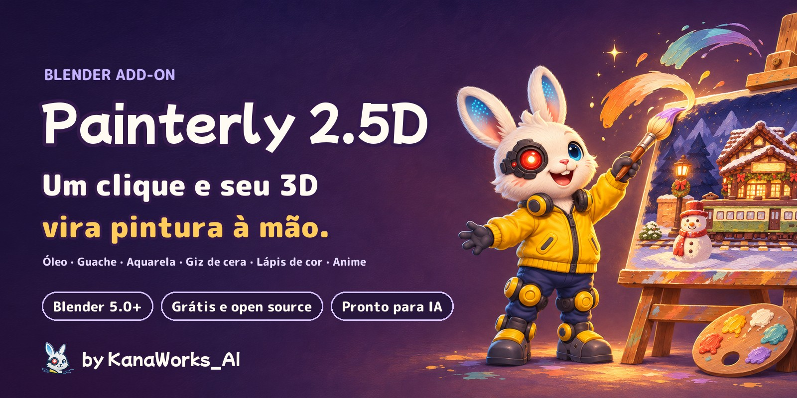
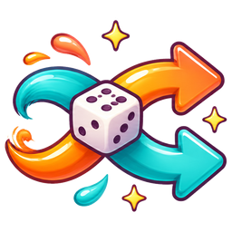
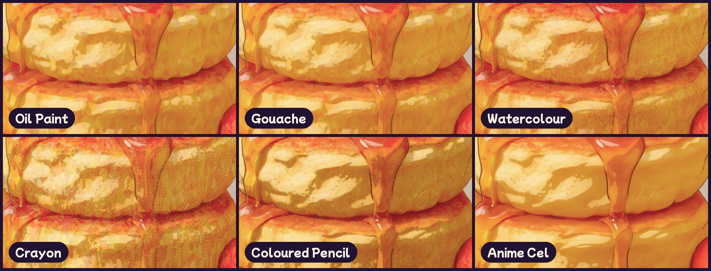
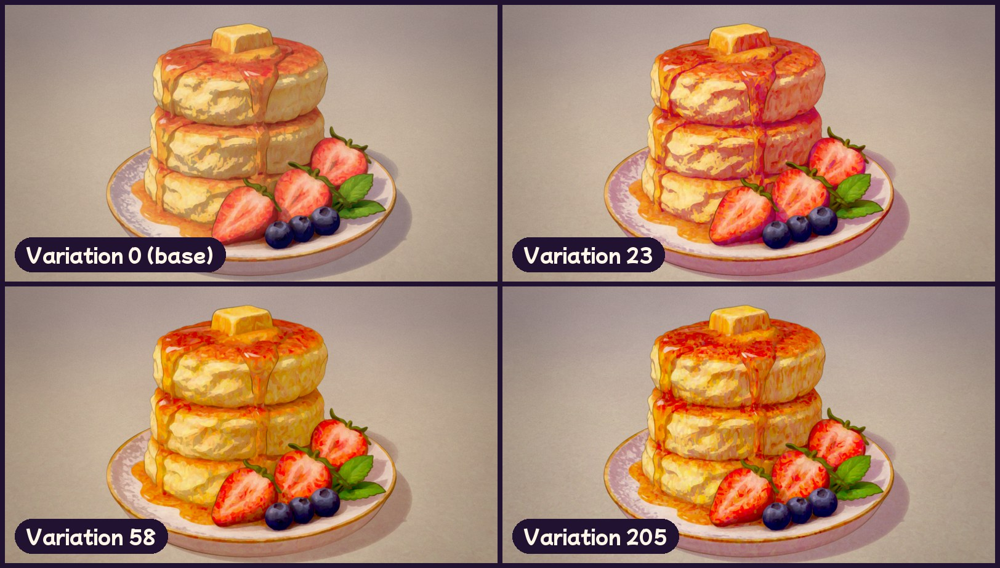
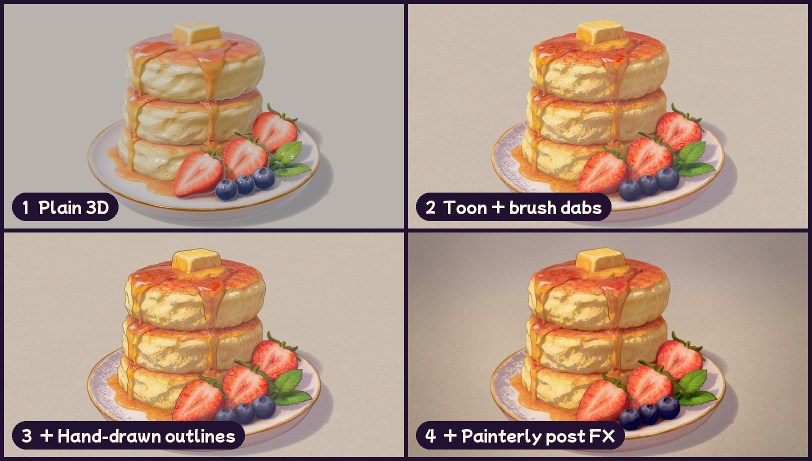
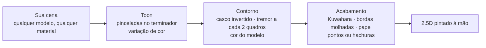
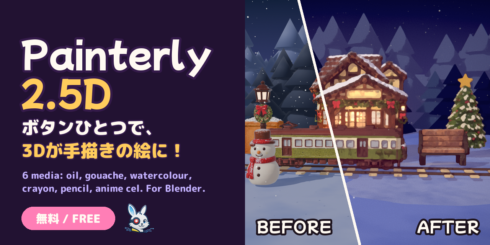

<div align="center">



<p>
  <a href="https://github.com/kanaworksai-hue/painterly-25d/releases/latest"></a>
  
  
  
  
  <a href="LICENSE"></a>
  <a href="NOTICE.md"></a>
  <a href="https://github.com/kanaworksai-hue/painterly-25d/stargazers"></a>
</p>

<p><a href="https://github.com/kanaworksai-hue"></a>&nbsp;<a href="https://github.com/kanaworksai-hue"><b>Um projeto KanaWorks_AI</b></a>&nbsp;·&nbsp;<a href="#-add-ons-da-kanaworks">Mais add-ons</a></p>

[日本語](README.md) | [English](README.en.md) | [简体中文](README.zh-CN.md) | [한국어](README.ko.md) | **Português** | [Español](README.es.md)

[🎨 Galeria](#-galeria) · [🚀 Primeiros passos](#-primeiros-passos) · [🎛️ O que dá para ajustar](#️-o-que-dá-para-ajustar) · [❓ Perguntas frequentes](#-perguntas-frequentes) · [⭐ Deixe uma estrela](#-apoie-com-uma-estrela)

</div>

**Painterly 2.5D** é um add-on gratuito para Blender que transforma qualquer cena em uma pintura feita à mão com um clique só. Ele aplica de uma vez toon shading com pinceladas só na transição entre luz e sombra, contornos desenhados à mão que tremem de dois em dois quadros e um filtro de acabamento com cara de tinta a óleo.

São **seis técnicas: óleo, guache, aquarela, giz de cera, lápis de cor e cel de anime**. Clique em **Shuffle** e a direção das pinceladas e as cores mudam a cada vez, então a mesma cena nunca precisa ficar igual duas vezes. Você também pode pedir para um agente de IA instalar e aplicar tudo com uma frase.

<p align="center">
  
  <br><sub>Mesma cena, mesma câmera. Esquerda: render normal. Direita: Painterly 2.5D.</sub>
</p>

## ✨ Recursos

<table>
<tr>
<td align="center" width="25%"><br><b>Um clique</b><br><sub>Configura EEVEE, materiais, contornos e compositor de uma vez só</sub></td>
<td align="center" width="25%"><br><b>Seis técnicas</b><br><sub>Óleo, guache, aquarela, giz de cera, lápis de cor, cel de anime</sub></td>
<td align="center" width="25%"><br><b>Shuffle</b><br><sub>Cada clique sorteia de novo a direção das pinceladas, a variação de cor, o tom da sombra, a cor das linhas e o papel</sub></td>
<td align="center" width="25%"><br><b>Peça para a sua IA</b><br><sub>Uma frase para o seu agente: instalação, aplicação e prévia, tudo automático</sub></td>
</tr>
</table>

- **Funciona em qualquer cena:** objetos sem material ganham um (as cores de vértice são mantidas) e, se a cena não tiver luz, uma luz principal é adicionada. Materiais Diffuse, Emission, só com imagem ou com node groups mantêm suas cores, vidros e superfícies transparentes ficam como estão, e instâncias de coleção também entram.
- **Se adapta a qualquer escala:** o tamanho das pinceladas, a névoa de profundidade e o esmaecimento dos contornos acompanham o tamanho dos objetos e a distância da câmera, então tanto um produto de 10 cm quanto um prédio de 50 m ficam certos.
- **Linhas na cor do modelo:** os contornos podem usar um tom mais escuro da cor de cada objeto (ou uma única cor de tinta para tudo).
- **Cinco presets:** Blue-hour Night, Golden Hour, Pastel Sweets, Storybook Day e Clean / Product. Combine com qualquer técnica.
- **Dá para desfazer:** *Revert Painterly* restaura seus materiais, o compositor e as configurações de visualização. As configurações são lidas dentro do shader, então o arquivo renderiza igual mesmo sem o add-on instalado.
- **Interface em English, 日本語 e 简体中文:** segue o idioma definido em *Preferences › Interface › Translation*.

## 🎨 Galeria

### Seis técnicas

Mesmo modelo, mesma luz. Só a técnica muda.



### Shuffle

Cada clique muda aleatoriamente a direção das pinceladas, a variação de cor, o tom da sombra, a cor das linhas e a cor do papel, dentro dos limites do preset e da técnica. Anote o número e você recupera o mesmo visual quando quiser.



### Qualquer modelo

Modelos CC0, a Suzanne do próprio Blender e modelos da autora, cada um com um único clique.


### Três camadas



## 🧭 Como funciona



1. **Toon:** Diffuse → Shader to RGB fornece a luz, que é dividida pela intensidade da luz principal para um corte de cel bem limpo. Só perto da linha entre luz e sombra, pinceladas de Voronoi inclinam a normal, e cada pincelada desloca um pouco o matiz, a saturação e o valor.
2. **Contorno:** um casco invertido em Geometry Nodes com espessura constante na tela, quebrado por ruído e redesenhado a cada dois quadros.
3. **Acabamento:** o compositor aplica névoa de profundidade → Kuwahara em duas passadas (protegendo as linhas) → escurecimento das bordas e granulação do pigmento → pontos ou hachuras nas sombras → bloom → papel → granulação de filme → correção de cor. Os tamanhos em pixels acompanham a resolução.

## 🚀 Primeiros passos

### Peça para o seu agente de IA (recomendado)

Mande isto para um agente de IA que consiga usar o seu computador, como o Claude Code ou o Codex:

> Siga o AGENTS.md de https://github.com/kanaworksai-hue/painterly-25d para instalar o Painterly 2.5D e deixar a minha cena do Blender com cara de pintura feita à mão.

Depois, é só ir ajustando com suas próprias palavras enquanto olha a prévia:

- "Deixa em aquarela"
- "Dá um clima de pôr do sol"
- "Me mostra outra versão"
- "Pinceladas maiores"
- "Linhas mais finas"

### Instalar manualmente

**Você precisa de:** Blender 5.0 ou mais recente (testado no Blender 5.2) e o motor de render EEVEE.

1. Baixe o `painterly_25d-x.y.z.zip` em [Releases](https://github.com/kanaworksai-hue/painterly-25d/releases/latest) (não descompacte).
2. Blender → Edit → Preferences → Get Extensions → menu ⌄ no canto superior direito → **Install from Disk…** → escolha o zip.


### Como usar

1. Abra a sua cena (qualquer modelo, quaisquer materiais).
2. No 3D Viewport, aperte **N** → aba **Painterly**.
3. Clique em **Make It Painterly**.
4. Escolha um **Preset** e um **Medium**. Na dúvida? Clique em **Shuffle**.
5. Faça o ajuste fino em *Toon & Strokes*, *Outline* e *Post FX* e renderize com **F12**.

<p align="center">
  
</p>

## 🎛️ O que dá para ajustar

<details>
<summary><b>Painel principal</b></summary>

| Opção | O que faz |
|---|---|
| Preset | Cor e clima (noite, golden hour, pastel, dia, clean) |
| Medium | Técnica (óleo, guache, aquarela, giz de cera, lápis de cor, cel de anime) |
| Variation / Shuffle | Um número que sorteia de novo a direção das pinceladas, a variação de cor, o tom da sombra, a cor das linhas e o papel. 0 = desligado |
| Selected Objects Only | Pinta só a seleção (padrão: a cena inteira) |
| Add Key Light if Missing | Adiciona um Sun do lado da câmera quando não há nenhuma luz (o Revert remove) |
| Fit to Scene Scale | Define pinceladas, névoa e esmaecimento dos contornos a partir do tamanho dos objetos e da distância da câmera |
| Revert Painterly | Restaura os materiais, o compositor e as configurações de visualização originais |

</details>

<details>
<summary><b>Técnicas</b></summary>

| Medium | Visual |
|---|---|
| **Oil Paint** (padrão) | Pinceladas grossas na borda entre luz e sombra, tinta com cara de óleo via Kuwahara |
| **Gouache** | Tinta chapada, opaca e fosca, com bordas suaves |
| **Watercolour** | Aguadas transparentes: o pigmento se acumula nas bordas, as bordas ondulam e o pigmento assenta no papel |
| **Crayon** | Traços cerosos, textura do papel aparecendo, sombras hachuradas |
| **Coloured Pencil** | Sombreado leve com sombras em hachura cruzada |
| **Anime Cel** | Cel shading e linhas bem nítidos, sem textura de tinta |

A técnica muda só *como* a tinta é aplicada; o preset muda só *a cor e o clima*, então qualquer combinação funciona.
</details>

<details>
<summary><b>Principais configurações detalhadas</b></summary>

| Grupo | Configurações |
|---|---|
| Pinceladas | Intensidade, escala, alongamento, distorção, **ângulo**, faixa do terminador, seed |
| Variação de cor | **Colour Jitter** (por pincelada), **Colour Drift** (manchas grandes) |
| Contorno | Espessura, cor da tinta, **Ink From Object Colour**, tremor da mão, tremor a cada 2 quadros |
| Técnica | **Edge Darkening**, **Wet Wobble**, **Granulation**, **Paper Tooth** |
| Padrão de sombra | **Dots / Hatching / Cross-hatching**, quantidade, espaçamento, cor |
| Filme | Papel, bloom, halation, granulação, aberração cromática, vinheta, correção de cor |

Ajustes por objeto para limiar, valor da sombra, pinceladas, brilho e espessura do contorno ficam em Object Properties.
</details>

## ❓ Perguntas frequentes

<details>
<summary><b>Funciona no Cycles?</b></summary>

Não. Ele usa o nó *Shader to RGB* do EEVEE, então renderize com o EEVEE. O **Make It Painterly** já muda a cena para o EEVEE para você.
</details>

<details>
<summary><b>As pinceladas estão grandes ou pequenas demais.</b></summary>

Depois de mover a câmera ou mudar a escala da cena, clique em *Fit to Scene* e ajuste o *Stroke Scale* (pinceladas por metro).
</details>

<details>
<summary><b>Está tudo iluminado e não aparece sombra nenhuma.</b></summary>

Worlds claros e HDRIs adicionam muita luz de preenchimento. Aumente o *Ambient Compensation*.
</details>

<details>
<summary><b>O que acontece com os meus materiais?</b></summary>

Um node group de toon é inserido e a conexão original fica guardada. O *Revert Painterly* coloca tudo de volta e ainda remove os materiais e as luzes que o add-on criou.
</details>

<details>
<summary><b>Posso usar as imagens e os vídeos comercialmente?</b></summary>

Pode. Os renders e vídeos que você fizer com o Painterly 2.5D são obra sua. A GPL vale para o código do add-on, não para o que você cria com ele (mas respeite as licenças dos modelos e texturas que usar). Ao publicar, coloque `Made with Painterly 2.5D by @KanaWorks_AI` (veja [Créditos](#-créditos)).
</details>

## 📝 Créditos

O Painterly 2.5D é gratuito, inclusive para uso comercial. Em troca, pedimos os créditos.

**Ao publicar imagens ou vídeos feitos com ele**, coloque isto no post, na descrição do vídeo ou nos créditos:

```
Made with Painterly 2.5D by @KanaWorks_AI
```

**Ao redistribuir, modificar ou incluir o add-on em outro produto** (forks, versões modificadas, ports, pacotes ou produtos que o incluam), é **obrigatório** manter esta linha, sem alterações, na descrição do add-on e na documentação (termo adicional da seção 7(b) da GPLv3; veja [NOTICE.md](NOTICE.md)):

```
Painterly 2.5D by KanaWorks_AI (@KanaWorks_AI) — https://github.com/kanaworksai-hue/painterly-25d
```

## ⭐ Apoie com uma estrela

Se você curtiu o Painterly 2.5D, uma **⭐ Star** no canto superior direito da [página do repositório](https://github.com/kanaworksai-hue/painterly-25d) ajuda muito. É grátis e leva um segundo.

- **Mais gente descobre o projeto:** as estrelas ajudam outras pessoas a encontrá-lo no GitHub.
- **Mais atualizações:** é o que mantém novas técnicas e presets chegando.

Relatos de bugs e ideias de recursos em [Issues](https://github.com/kanaworksai-hue/painterly-25d/issues), ou seus renders no X marcando [@KanaWorks_AI](https://x.com/KanaWorks_AI), também são muito bem-vindos.

## 🧩 Add-ons da KanaWorks

Add-ons gratuitos e de código aberto para Blender, da mesma autora. Todos podem ser instalados e aplicados pelo seu agente de IA.

<table>
<tr>
<td align="center" width="33%"><a href="https://github.com/kanaworksai-hue/painterly-25d"></a><br><b>Painterly 2.5D</b> (esta página)<br><sub>3D em arte pintada à mão: óleo, aquarela, giz de cera, cel de anime</sub></td>
<td align="center" width="33%"><a href="https://github.com/kanaworksai-hue/kirapaint"></a><br><b><a href="https://github.com/kanaworksai-hue/kirapaint">KiraPaint</a></b><br><sub>2.5D pintado e cintilante: brilho de diamante triturado e reflexos em estrela</sub></td>
<td align="center" width="33%"><a href="https://github.com/kanaworksai-hue/mochitoon"></a><br><b><a href="https://github.com/kanaworksai-hue/mochitoon">MochiToon</a></b><br><sub>Estilo mangá fofo: sombras coloridas, retículas de coração e estrela</sub></td>
</tr>
</table>

## 🛠️ Desenvolvimento

```bash
# headless test (every feature on a scene it was never tuned for)
blender -b --factory-startup --python tests/test_generic.py

# build the installable zip into dist/
BLENDER=blender ./build.sh
```

```
painterly_25d/
  __init__.py      settings, presets / media / variation, operators, panels
  toon.py          toon shader node group (brush dabs, colour jitter, shadow colour)
  outline.py       Geometry Nodes outline and the model-coloured ink material
  post.py          compositor (Kuwahara, wet edges, dots / hatching, paper, grade)
  autosetup.py     make it work on any scene (materials, lights, scale)
  translations.py  Japanese and Simplified Chinese UI
agent/painterly_agent.py  command line for AI agents
```

## 📄 Licença e créditos

- **Este add-on:** Copyright © 2026 東京AI映像合同会社 (Tokyo AI Visuals LLC), distribuído sob a [GPL-3.0-or-later](LICENSE) (com um termo adicional que exige esta atribuição na redistribuição; veja [NOTICE.md](NOTICE.md)).
- **Marca:** o nome KanaWorks_AI, o logo e a personagem Kana pertencem à Tokyo AI Visuals LLC e **não** são cobertos pela GPL. Veja [docs/brand](docs/brand/README.md).
- Inspirado em análises públicas de NPR da comunidade Blender (cel shading com Shader to RGB, composição com Kuwahara, contornos com casco invertido).
- **Blender** é marca registrada da Blender Foundation. Este é um projeto independente, sem afiliação nem endosso da Blender Foundation.

<br>

<div align="center">

<a href="https://x.com/KanaWorks_AI"></a>

<p><b>Feito com ♥ por <a href="https://x.com/KanaWorks_AI">KanaWorks_AI</a></b></p>

<p><sub>Se o Painterly 2.5D te ajudou, uma ⭐ mantém as atualizações chegando. Mais projetos: <a href="https://github.com/kanaworksai-hue">github.com/kanaworksai-hue</a></sub></p>

</div>
