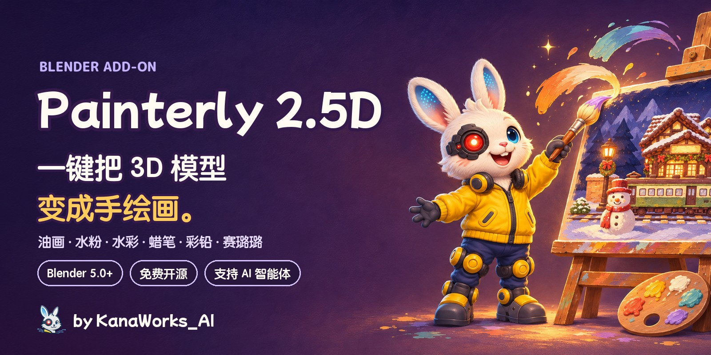
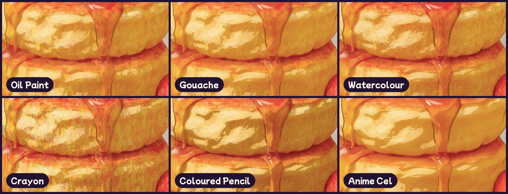
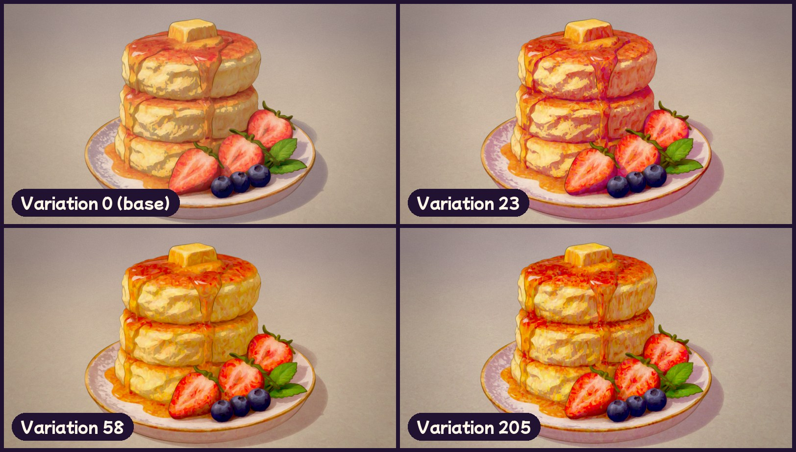
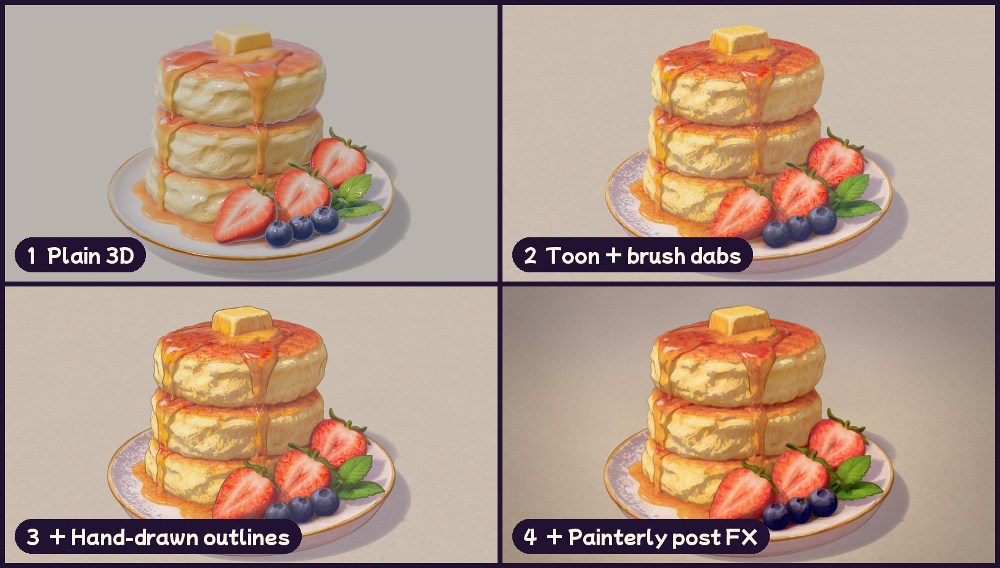
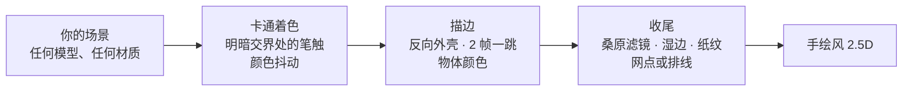
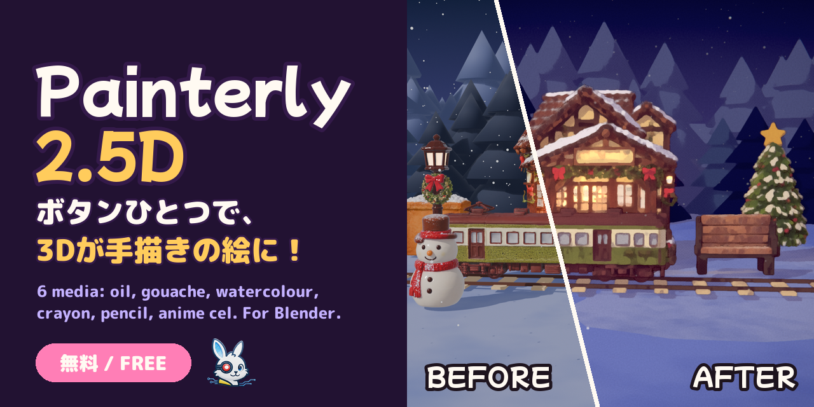

<div align="center">



<p>
  <a href="https://github.com/kanaworksai-hue/painterly-25d/releases/latest"></a>
  
  
  
  
  <a href="LICENSE"></a>
  <a href="https://github.com/kanaworksai-hue/painterly-25d/stargazers"></a>
</p>

<p><a href="https://github.com/kanaworksai-hue"></a>&nbsp;<a href="https://github.com/kanaworksai-hue"><b>KanaWorks_AI 的项目</b></a>&nbsp;·&nbsp;<a href="#-kanaworks-的插件">系列一览</a></p>

[日本語](README.md) | [English](README.en.md) | **简体中文** | [한국어](README.ko.md) | [Português](README.pt-BR.md) | [Español](README.es.md)

[🎨 作品展示](#-作品展示) · [🚀 快速开始](#-快速开始) · [🎛️ 可调整的内容](#️-可调整的内容) · [❓ 常见问题](#-常见问题) · [⭐ 点个 Star](#-点个-star-支持一下)

</div>

**Painterly 2.5D** 是一个免费的 Blender 插件，点一下就能把场景变成"手绘画"。它会同时加上三层效果：只在明暗交界处出现笔触的卡通着色、按 2 帧一跳抖动的手绘描边，以及油画般的收尾滤镜。

可以在**油画、水粉、水彩、蜡笔、彩色铅笔、动画赛璐璐**六种画材之间切换；每按一次**随机一下（Shuffle）**，笔触方向和色调都会变化，同一个场景也能每次画出不一样的一张。从安装到应用，也可以一句话交给 AI 智能体来完成。

<p align="center">
  
  <br><sub>同一场景、同一机位。左边是普通渲染，右边是 Painterly 2.5D。</sub>
</p>

## ✨ 特点

<table>
<tr>
<td align="center" width="25%"><br><b>一键完成</b><br><sub>EEVEE、材质、描边、合成节点一次设置好</sub></td>
<td align="center" width="25%"><br><b>六种画材</b><br><sub>油画、水粉、水彩、蜡笔、彩色铅笔、动画赛璐璐</sub></td>
<td align="center" width="25%"><br><b>随机一下</b><br><sub>每按一次，笔触方向、颜色抖动、阴影色、线条色、纸张都会变化</sub></td>
<td align="center" width="25%"><br><b>交给 AI</b><br><sub>对智能体说一句，自动安装、应用、出预览</sub></td>
</tr>
</table>

- **任何场景都能用：** 没有材质的物体会自动创建材质（保留顶点色），场景里没有灯光时会自动加主光。Diffuse、Emission、只有贴图、节点组等材质都会保留原有颜色；玻璃和半透明表面保持原样；也支持集合实例。
- **自动适配尺寸：** 根据物体大小和相机距离设置笔触、深度雾和描边渐隐，10 厘米的小物件和 50 米的建筑都能得到同样的效果。
- **线条带物体颜色：** 描边可以使用每个物体自身颜色加深后的颜色（也可以统一成一种墨色）。
- **五种预设：** 蓝调夜晚、黄金时刻、马卡龙甜点、绘本白天、简洁／产品，可以和任意画材自由组合。
- **可以还原：** 点「撤销绘画风格」即可恢复原材质、合成节点和视图设置。参数在着色器内部读取，没有安装插件的电脑也能渲染出相同效果。
- **界面支持中文、日文和英文：** 跟随 Blender「偏好设置 › 界面 › 翻译」。

## 🎨 作品展示

### 六种画材

同一个模型、同一套灯光，只切换画材。



### 随机一下

每按一次，笔触方向、颜色抖动、阴影色、线条色、纸张颜色都会在当前预设和画材的范围内随机变化。记下编号，随时都能还原同样的效果。



### 任何模型都可以

CC0 模型、Blender 自带的苏珊、作者准备的模型，都只点了一次。


### 三层效果



## 🧭 原理



1. **卡通着色：** Diffuse → Shader to RGB 取得明暗，再除以主光强度做分阶。只在明暗交界附近用 Voronoi 笔触扰动法线，每个笔触的色相、饱和度、明度都会有细微差别。
2. **描边：** 几何节点反向外壳，屏幕上粗细恒定，用噪波打断，每 2 帧重画一次。
3. **收尾：** 合成节点依次做深度雾 → 两次桑原滤镜（保护线条）→ 边缘积色和颜料颗粒 → 阴影里的网点或排线 → 泛光 → 纸纹 → 颗粒 → 调色。所有像素尺寸都随分辨率自动缩放。

## 🚀 快速开始

### 交给 AI 智能体（推荐）

把下面这句话发给能操作电脑的 AI 智能体（比如 Claude Code 或 Codex）：

> 按照 https://github.com/kanaworksai-hue/painterly-25d 里的 AGENTS.md 安装 Painterly 2.5D，把我的 Blender 场景做成手绘画风格。

之后看着预览，一句话就能继续调整：

- 「改成水彩」
- 「来点夕阳的感觉」
- 「再换一个版本看看」
- 「笔触大一点」
- 「线条细一点」

### 自己安装

**需要：** Blender 5.0 及以上（已在 Blender 5.2 上测试），渲染引擎 EEVEE。

1. 从 [Releases](https://github.com/kanaworksai-hue/painterly-25d/releases/latest) 下载 `painterly_25d-x.y.z.zip`（不要解压）。
2. Blender → 编辑 → 偏好设置 → Get Extensions → 右上角 ⌄ 菜单 → **Install from Disk…** → 选择 zip。


### 使用方法

1. 打开你的场景（任何模型、任何材质都可以）。
2. 在 3D 视图里按 **N**，打开 **Painterly** 标签页。
3. 点击 **Make It Painterly**（一键绘画风格）。
4. 选择**预设**和**画材**。拿不定主意就点**随机一下**。
5. 在「卡通与笔触」「描边」「后期效果」里微调，按 **F12** 渲染。

<p align="center">
  
</p>

## 🎛️ 可调整的内容

<details>
<summary><b>主面板</b></summary>

| 选项 | 作用 |
|---|---|
| 预设 | 颜色与氛围（夜晚、夕阳、马卡龙、白天、简洁） |
| 画材 | 画法（油画、水粉、水彩、蜡笔、彩色铅笔、动画赛璐璐） |
| 变化 / 随机一下 | 随机改变笔触方向、颜色抖动、阴影色、线条色和纸张的编号，0 为关闭 |
| 仅选中物体 | 只处理选中的物体（默认处理整个场景） |
| 缺少主光时自动添加 | 场景没有灯光时，从相机一侧添加日光（撤销时删除） |
| 适配场景尺寸 | 根据大小和相机距离设置笔触、雾和描边渐隐 |
| 撤销绘画风格 | 恢复原材质、合成节点和视图设置 |

</details>

<details>
<summary><b>画材</b></summary>

| 画材 | 效果 |
|---|---|
| **油画**（默认） | 明暗交界处厚重的笔触，桑原滤镜带来油画质感 |
| **水粉** | 不透明、哑光的平涂，边缘柔和 |
| **水彩** | 透明的晕染：颜料积在边缘、轮廓晕开、颜料沉进纸纹 |
| **蜡笔** | 蜡质笔触，纸面纹理透白，阴影里有排线 |
| **彩色铅笔** | 轻柔的笔触和交叉排线的阴影 |
| **动画赛璐璐** | 干净利落的色块和线条，没有颜料质感 |

画材只改变「怎么画」，预设只改变「颜色与氛围」，所以可以任意组合。
</details>

<details>
<summary><b>主要的细节设置</b></summary>

| 分组 | 项目 |
|---|---|
| 笔触 | 强度、密度、拉伸、扭曲、**方向**、明暗交界带、种子 |
| 颜色变化 | **颜色抖动**（每个笔触）、**颜色斑驳**（大块色斑） |
| 描边 | 粗细、线条颜色、**线条使用物体颜色**、手绘抖动、2 帧一跳 |
| 画材 | **边缘积色**、**湿边抖动**、**颜料颗粒沉淀**、**纸面纹理** |
| 阴影图案 | **网点 / 排线 / 交叉排线**、强度、间距、颜色 |
| 胶片 | 纸纹、泛光、光晕、颗粒、色差、暗角、调色 |

在物体属性里还可以单独覆盖阈值、阴影明度、笔触、发光和描边粗细。
</details>

## ❓ 常见问题

<details>
<summary><b>Cycles 能用吗？</b></summary>

不能。插件用到了 EEVEE 专用的 Shader to RGB 节点，请用 EEVEE 渲染。点 **Make It Painterly** 时会自动切换到 EEVEE。
</details>

<details>
<summary><b>笔触太大或太小。</b></summary>

移动相机或缩放场景后，先点「适配场景」，再调整「笔触密度」（每米的笔触数量）。
</details>

<details>
<summary><b>整体太亮，看不到阴影。</b></summary>

明亮的世界环境和 HDRI 会带来很强的补光，请调高「环境光补偿」。
</details>

<details>
<summary><b>原来的材质会怎样？</b></summary>

插件会插入卡通节点组，并记住原来的连接。点「撤销绘画风格」就能复原，插件自动创建的材质和灯光也会一起删除。
</details>

<details>
<summary><b>做出来的图片和视频可以商用吗？</b></summary>

可以。用 Painterly 2.5D 渲染的图片和视频是你自己的作品，可以自由使用。GPL 只适用于插件本身的代码，不适用于用它做出来的作品（使用的模型和贴图请遵守它们各自的授权）。
</details>

## ⭐ 点个 Star 支持一下

如果你喜欢 Painterly 2.5D，欢迎在[仓库页面](https://github.com/kanaworksai-hue/painterly-25d)右上角点一下 **⭐ Star**。免费，只要一秒钟。

- **让更多人看到：** Star 越多，越容易在 GitHub 上被发现。
- **更新的动力：** 支持我继续做新的画材和预设。

也非常欢迎在 [Issue](https://github.com/kanaworksai-hue/painterly-25d/issues) 里反馈 bug 和想要的功能，或者在 X 上带上 [@KanaWorks_AI](https://x.com/KanaWorks_AI) 分享你的作品。

## 🧩 KanaWorks 的插件

同一作者的免费开源 Blender 插件，都可以一句话交给 AI 智能体安装和使用。

<table>
<tr>
<td align="center" width="33%"><a href="https://github.com/kanaworksai-hue/painterly-25d"></a><br><b>Painterly 2.5D</b>（本页）<br><sub>把 3D 变成手绘画：油画、水彩、蜡笔、动画赛璐璐</sub></td>
<td align="center" width="33%"><a href="https://github.com/kanaworksai-hue/kirapaint"></a><br><b><a href="https://github.com/kanaworksai-hue/kirapaint">KiraPaint</a></b><br><sub>亮晶晶的绘画风 2.5D：碎钻光泽和星光</sub></td>
<td align="center" width="33%"><a href="https://github.com/kanaworksai-hue/mochitoon"></a><br><b><a href="https://github.com/kanaworksai-hue/mochitoon">MochiToon</a></b><br><sub>可爱的漫画风：彩色阴影、爱心和星星网点</sub></td>
</tr>
</table>

## 🛠️ 开发

```bash
# 无界面测试（在没有专门调过的通用场景上检查所有功能）
blender -b --factory-startup --python tests/test_generic.py

# 在 dist/ 生成可安装的 zip
BLENDER=blender ./build.sh
```

```
painterly_25d/
  __init__.py      参数、预设 / 画材 / 变化、操作、面板
  toon.py          卡通着色节点组（笔触、颜色抖动、阴影色）
  outline.py       几何节点描边，以及使用物体颜色的线条材质
  post.py          合成节点（桑原、湿边、网点 / 排线、纸纹、调色）
  autosetup.py     让任何场景都能用的自动设置（材质、灯光、尺寸）
  translations.py  日文和简体中文界面
agent/painterly_agent.py  给 AI 智能体用的命令行
```

## 📄 许可证与致谢

- **本插件：** Copyright © 2026 东京AI映像合同会社（Tokyo AI Visuals LLC），以 [GPL-3.0-or-later](LICENSE) 发布。
- **品牌：** KanaWorks_AI 的名称、logo 和 Kana 形象的权利归东京AI映像合同会社所有，**不在** GPL 授权范围内。详见 [docs/brand](docs/brand/README.md)。
- 参考了 Blender 社区公开分享的 NPR 制作思路（Shader to RGB 卡通着色、桑原滤镜合成、反向外壳描边）。
- **Blender** 是 Blender Foundation 的商标。本项目为独立项目，与 Blender Foundation 没有合作关系，也未获其认可。

<br>

<div align="center">

<a href="https://x.com/KanaWorks_AI"></a>

<p><b>Made with ♥ by <a href="https://x.com/KanaWorks_AI">KanaWorks_AI</a></b></p>

<p><sub>如果 Painterly 2.5D 帮到了你，一个 ⭐ 就是下次更新的动力。更多项目：<a href="https://github.com/kanaworksai-hue">github.com/kanaworksai-hue</a></sub></p>

</div>
